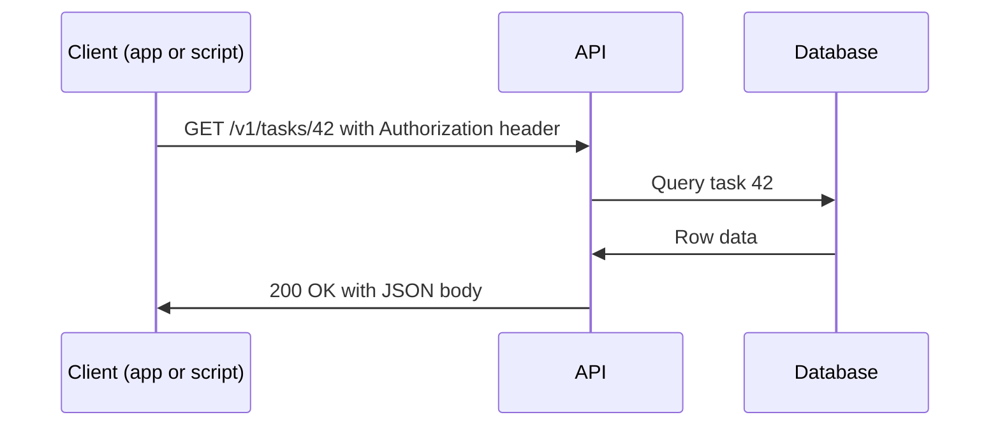
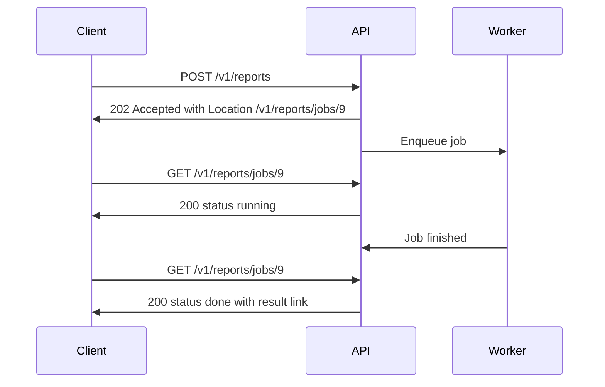
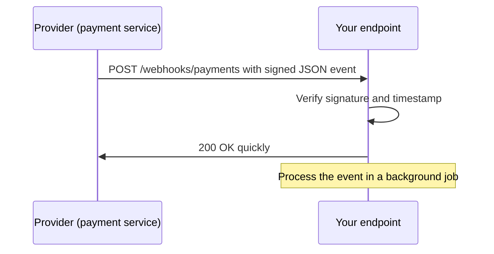
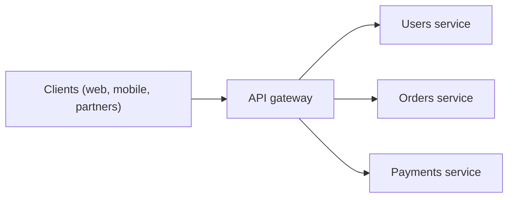

# APIs Explained: Design, REST, Security, Versioning, GraphQL, gRPC, Webhooks

A beginner-to-engineer reference for everything about APIs: what they are, the different styles, how to design a good REST API (URLs, methods, status codes, errors, pagination, versioning), how to secure and document it, how to build real-time and event-driven APIs, and how to consume other people's APIs safely. It finishes with a complete FastAPI example, a design checklist, and interview questions.

---

## Quick summary

- An **API** (Application Programming Interface) is a **contract** that lets one piece of software use another without knowing how it works inside.
- A **web API** is that contract over the network, usually **HTTP + JSON**.
- **REST** is the default style: **resources as nouns in URLs**, **HTTP methods as verbs**, **status codes for results**.
- A good API is **predictable, consistent, well documented, versioned, secure, and hard to misuse**.
- Must-have habits: **validate input, consistent errors, pagination, idempotency for retries, rate limiting, authorization on every object, and an OpenAPI spec**.
- Other styles exist for specific needs: **GraphQL** (flexible queries), **gRPC** (fast internal calls), **WebSockets/SSE** (real-time), **webhooks** (server-to-server events).

---

## Table of contents

1. [What is an API](#1-what-is-an-api)
2. [API styles at a glance](#2-api-styles-at-a-glance)
3. [REST principles](#3-rest-principles)
4. [Designing resources and URLs](#4-designing-resources-and-urls)
5. [Methods and status codes in practice](#5-methods-and-status-codes-in-practice)
6. [Request and response design](#6-request-and-response-design)
7. [Validation and error handling](#7-validation-and-error-handling)
8. [Pagination, filtering, sorting and search](#8-pagination-filtering-sorting-and-search)
9. [Versioning and compatibility](#9-versioning-and-compatibility)
10. [Idempotency, retries and concurrency control](#10-idempotency-retries-and-concurrency-control)
11. [Rate limiting and quotas](#11-rate-limiting-and-quotas)
12. [Long-running operations](#12-long-running-operations)
13. [Files, bulk operations and streaming](#13-files-bulk-operations-and-streaming)
14. [API authentication and authorization](#14-api-authentication-and-authorization)
15. [API security](#15-api-security)
16. [Performance and caching](#16-performance-and-caching)
17. [GraphQL](#17-graphql)
18. [gRPC](#18-grpc)
19. [Real-time APIs and webhooks](#19-real-time-apis-and-webhooks)
20. [API gateways and infrastructure](#20-api-gateways-and-infrastructure)
21. [Documentation and contracts (OpenAPI)](#21-documentation-and-contracts-openapi)
22. [Testing APIs](#22-testing-apis)
23. [Consuming APIs (client side)](#23-consuming-apis-client-side)
24. [Full example: a small REST API (FastAPI)](#24-full-example-a-small-rest-api-fastapi)
25. [API design checklist](#25-api-design-checklist)
26. [Common pitfalls and interview questions](#26-common-pitfalls-and-interview-questions)

Related guides: [HTTP and HTTPS](http-https-guide.md), [Authentication and Authorization](authentication-guide.md), [Introduction to Backend Development](backend-development-intro.md).

---

## 1. What is an API

An **API** is an agreed way for programs to talk to each other. You call it with a defined **request**, and it gives you a defined **response**. You do not need to know how it is built inside, only how to use it.

**Everyday analogy**: a restaurant menu. The menu (API) lists what you can order and how. You never walk into the kitchen. The kitchen can change its recipes without changing the menu.

Kinds of APIs:

| Kind | Example |
|---|---|
| **Library / language API** | `list.append()` in Python, `Math.max()` in JavaScript |
| **Operating system API** | Reading a file, opening a socket |
| **Web API** | `GET https://api.example.com/v1/users/42` |

This guide is about **web APIs**.

**Who uses an API**

- **Private / internal**: used inside one company (frontend to backend, service to service).
- **Partner**: shared with selected business partners.
- **Public / open**: anyone can sign up and use it (Stripe, GitHub, Google Maps).

**Why APIs matter**

- Frontend, mobile, and third parties all share one backend.
- Teams work independently as long as the **contract** stays stable.
- Systems can be combined (payments, maps, email, AI) without rebuilding them.

The basic flow:



---

## 2. API styles at a glance

| Style | How it works | Strengths | Weaknesses | Typical use |
|---|---|---|---|---|
| **REST** | Resources + HTTP methods + JSON | Simple, cacheable, universal, tooling everywhere | Over/under-fetching, many round trips | Default for web and mobile APIs |
| **SOAP** | XML messages with a strict contract (WSDL) | Formal contracts, built-in standards | Verbose, heavy | Legacy enterprise, banking |
| **GraphQL** | One endpoint, client writes the query | Exact data, fewer requests | Harder caching, query cost control | Many clients with different needs |
| **gRPC** | Protocol Buffers over HTTP/2 | Fast, typed, streaming | Not browser-friendly by default, binary | Internal service-to-service |
| **WebSocket** | Persistent two-way connection | Real-time both directions | Stateful, harder to scale | Chat, games, live data |
| **Server-Sent Events** | Server pushes events one way over HTTP | Simple, auto-reconnect | One direction only | Notifications, live feeds |
| **Webhooks** | Server calls your URL when an event happens | Efficient, no polling | You must host and secure an endpoint | Payments, Git events |

**RPC vs resource style**: RPC-style APIs expose actions (`/createUser`, `/sendEmail`). REST-style APIs expose things (`/users`, `/emails`). Both are valid; REST is the most common for public web APIs.

---

## 3. REST principles

**REST** (Representational State Transfer) is a set of design constraints for networked systems:

1. **Client-server**: the UI and the data storage are separate concerns.
2. **Stateless**: every request contains everything needed to handle it. The server stores no client session between requests (auth data travels with each request).
3. **Cacheable**: responses say whether they can be cached.
4. **Uniform interface**: resources are identified by URLs, handled through standard methods, and returned as **representations** (e.g. JSON).
5. **Layered system**: proxies, gateways, and caches can sit in between.
6. *(Optional)* **Code on demand**: server sends executable code.

A **resource** is a "thing" (user, order, task). A **representation** is how it is shown (JSON, XML). The same resource at `/tasks/42` can have different representations.

**Richardson Maturity Model** (how "RESTful" an API is):

| Level | Description |
|---|---|
| 0 | One URL and one method for everything (`POST /api` with an action in the body) |
| 1 | Separate **resources** with their own URLs |
| 2 | Proper **HTTP methods and status codes** (most real APIs stop here) |
| 3 | **Hypermedia (HATEOAS)**: responses include links to what you can do next |

Hypermedia example (level 3):

```json
{
  "id": 42,
  "status": "pending",
  "_links": {
    "self":   { "href": "/v1/orders/42" },
    "cancel": { "href": "/v1/orders/42/cancel", "method": "POST" },
    "items":  { "href": "/v1/orders/42/items" }
  }
}
```

Most teams do not need full HATEOAS, and "REST-ish JSON over HTTP" at level 2 is normal and fine.

---

## 4. Designing resources and URLs

**Rules**

- **Use nouns, not verbs**: `/users`, not `/getUsers`. The HTTP method is the verb.
- **Use plural nouns**: `/users`, `/users/42`.
- **Show hierarchy only when it is real ownership**, and keep it shallow (about two levels):
  - Good: `/users/42/orders`
  - Avoid: `/users/42/orders/7/items/3/reviews/9`. Prefer `/reviews/9`.
- **Be consistent**: pick one naming style for paths (`kebab-case`, lowercase) and for JSON fields (`snake_case` or `camelCase`) and keep it everywhere.
- **Use query strings for filtering, sorting, pagination**, not for identifying a resource.
- **No trailing slash confusion**: choose one form (usually none) and redirect or reject the other.
- **Use opaque, stable IDs**: UUIDs or similar. Do not expose internal database details. (Hard-to-guess IDs help, but **never replace authorization checks**.)
- **Do not put secrets in URLs**: URLs end up in logs, browser history, and referrers.

**Actions that do not fit CRUD**

Sometimes you need an action ("cancel an order", "publish a post"). Options:

```
POST /v1/orders/42/cancel         # sub-resource style action, common and clear
POST /v1/posts/7/publish
PATCH /v1/orders/42  {"status": "cancelled"}   # model it as a state change
POST /v1/cancellations {"order_id": 42}        # model the action as its own resource
```

Pick one convention and keep it consistent.

**Examples**

| Good | Bad |
|---|---|
| `GET /v1/products?category=books` | `GET /v1/getProductsByCategory?c=books` |
| `POST /v1/users` | `POST /v1/createNewUser` |
| `DELETE /v1/users/42` | `GET /v1/deleteUser?id=42` |
| `GET /v1/users/42/orders` | `GET /v1/orders/forUser/42` |

---

## 5. Methods and status codes in practice

(Details about each method and code are in the [HTTP and HTTPS guide](http-https-guide.md).)

**Standard CRUD mapping**

| Operation | Method and URL | Success | Common errors |
|---|---|---|---|
| List | `GET /tasks` | `200` | `400` bad params, `401` |
| Create | `POST /tasks` | **`201`** + `Location` header | `400/422` invalid, `409` conflict |
| Read one | `GET /tasks/42` | `200` | `404` |
| Replace | `PUT /tasks/42` | `200` or `204` | `404`, `422` |
| Partial update | `PATCH /tasks/42` | `200` (with body) or `204` | `404`, `422` |
| Delete | `DELETE /tasks/42` | **`204`** | `404` (or `204` if already gone) |

**Status code cheat sheet for APIs**

| Situation | Code |
|---|---|
| Everything fine | `200 OK` |
| Resource created | `201 Created` |
| Accepted, will finish later | `202 Accepted` |
| Success with nothing to return | `204 No Content` |
| Malformed request / bad parameters | `400 Bad Request` |
| Not logged in or bad credentials | `401 Unauthorized` |
| Logged in but not allowed | `403 Forbidden` |
| Does not exist (or hidden from you) | `404 Not Found` |
| Method not supported here | `405 Method Not Allowed` |
| State conflict (duplicate, version clash) | `409 Conflict` |
| Valid format, invalid content | `422 Unprocessable Content` |
| Precondition failed (`If-Match` mismatch) | `412 Precondition Failed` |
| Too many requests | `429 Too Many Requests` |
| Bug on the server | `500 Internal Server Error` |
| Upstream failure / overload | `502 / 503 / 504` |

Rules: **never return `200 OK` with an error inside the body**, and never leak stack traces in `5xx` responses.

---

## 6. Request and response design

- **Use JSON** with `Content-Type: application/json`. Always return the correct `Content-Type`.
- **Dates and times**: use **ISO 8601 in UTC**, e.g. `"2026-10-19T12:30:00Z"`. Convert to local time only in the UI.
- **Money**: never use floating point. Use integers in the smallest unit (`"amount": 1999, "currency": "USD"` = $19.99) or a decimal string.
- **Booleans, enums, and null**: use real JSON booleans, a fixed set of enum strings, and `null` only when "no value" is meaningful. Document it.
- **Keep response shapes consistent**: a list endpoint always returns the same structure, even when empty.
- **Return the created/updated resource** from `POST`/`PUT`/`PATCH` so the client does not need another call.
- **Do not expose internals**: never return password hashes, internal flags, or other users' data.
- **Use separate models for input and output** (a *create* schema, an *update* schema, a *response* schema). This also prevents **mass assignment** (a client setting `is_admin: true` just by adding a field).

**Envelope or not?**

```json
// Plain
[ {"id": 1, "title": "A"}, {"id": 2, "title": "B"} ]

// Envelope (room for metadata, usually better for lists)
{
  "items": [ {"id": 1, "title": "A"}, {"id": 2, "title": "B"} ],
  "total": 57,
  "limit": 20,
  "offset": 0
}
```

Returning an object (not a bare array) at the top level lets you add fields later without breaking clients.

**Partial updates (PATCH)**

- **JSON Merge Patch** (`application/merge-patch+json`): send only fields to change; `null` removes a field. Simple and common.
- **JSON Patch** (`application/json-patch+json`): a list of operations (`add`, `remove`, `replace`).

```json
// Merge Patch: change only "done"
{ "done": true }

// JSON Patch
[ { "op": "replace", "path": "/done", "value": true } ]
```

**Sparse fields and embedding (optional niceties)**

- `GET /tasks/42?fields=id,title` (return fewer fields)
- `GET /orders/7?include=items,customer` (embed related resources to save round trips)

---

## 7. Validation and error handling

**Validate everything on the server**: types, ranges, lengths, formats, enums, required fields, and business rules. Never rely on the frontend.

**Use one consistent error format.** A standard exists: **Problem Details for HTTP APIs (RFC 9457)**, media type `application/problem+json`.

```http
HTTP/1.1 422 Unprocessable Content
Content-Type: application/problem+json

{
  "type": "https://api.example.com/problems/validation-error",
  "title": "Validation failed",
  "status": 422,
  "detail": "One or more fields are invalid.",
  "instance": "/v1/tasks",
  "errors": [
    { "field": "title", "message": "must not be empty" },
    { "field": "priority", "message": "must be one of: low, medium, high" }
  ]
}
```

**Good error practice**

- Use the **right status code**, plus a machine-readable **error code** and a human-readable **message**.
- Report **all** validation errors at once, not one at a time.
- Do not reveal sensitive details (SQL errors, stack traces, internal paths, whether a username exists).
- For login failures, use a generic message (see the Authentication guide).
- Include a **request/correlation ID** (e.g. `X-Request-Id`) in responses and logs so you can trace problems.
- Handle errors in one central place (middleware or exception handlers) so the format is the same everywhere.

---

## 8. Pagination, filtering, sorting and search

Never return an unbounded list. Always paginate, with a **default and a maximum page size**.

### Pagination styles

| Style | Example | Pros | Cons |
|---|---|---|---|
| **Offset / limit** | `?limit=20&offset=40` | Simple, jump to any page | Slow on huge tables, results can shift when data changes |
| **Page number** | `?page=3&per_page=20` | Easy for UIs | Same as offset |
| **Cursor / keyset** | `?limit=20&after=eyJpZCI6NDJ9` | Fast and stable on big or changing data | Cannot jump to arbitrary pages |

**Cursor response example**

```json
{
  "items": [ ... ],
  "next_cursor": "eyJpZCI6NjJ9",
  "has_more": true
}
```

Keyset idea in SQL (fast, uses an index):

```sql
SELECT * FROM tasks
WHERE id < :last_seen_id
ORDER BY id DESC
LIMIT 20;
```

**Tips**

- Cursors should be **opaque** (Base64 or encrypted), so clients do not depend on their internals.
- A `total` count can be expensive on large tables. Offer it only if needed.
- You can also expose navigation through the `Link` header (`rel="next"`, `rel="prev"`).

### Filtering, sorting, searching

```
GET /v1/tasks?done=false&priority=high            # filter
GET /v1/tasks?created_after=2026-01-01            # range filter
GET /v1/tasks?sort=-created_at,title              # sort (minus = descending)
GET /v1/tasks?q=invoice                           # simple search
```

- **Whitelist** the fields clients may filter and sort on (protects performance and security).
- Validate values, and make sure filtered columns are **indexed**.
- For complex search, use a dedicated search engine (Elasticsearch, OpenSearch, Postgres full-text search).

---

## 9. Versioning and compatibility

APIs have users you cannot control. Changing behavior can break them, so you need a **versioning** strategy.

| Strategy | Example | Notes |
|---|---|---|
| **URL path** | `/v1/users` | Most common, very visible, easy to route and cache |
| **Header** | `Accept: application/vnd.example.v2+json` | Clean URLs, harder to test in a browser |
| **Query param** | `/users?version=2` | Simple but easy to forget |

**Breaking vs non-breaking changes**

| Non-breaking (safe) | Breaking (needs a new version) |
|---|---|
| Add a new endpoint | Remove or rename an endpoint or field |
| Add an **optional** field or parameter | Make an optional field required |
| Add a new enum value (if clients are tolerant) | Change a field's type or meaning |
| Add a new response field | Change status codes or error formats |

**Best practices**

- **Prefer additive changes** and avoid new versions when possible.
- Tell clients to be **tolerant readers**: ignore unknown fields.
- **Deprecate before removing**: announce it, give a timeline, and use response headers such as `Deprecation` and `Sunset`. Monitor who still uses the old version.
- Keep a **changelog**.
- Support at most a few versions at once. Every extra version costs maintenance and testing.
- Internal APIs can sometimes skip versioning if you control all clients and deploy together.

---

## 10. Idempotency, retries and concurrency control

Networks fail. Clients retry. Your API must handle repeated requests safely.

### Idempotency

- `GET`, `PUT`, `DELETE` are naturally idempotent. **`POST` is not.**
- For operations like payments or order creation, support an **idempotency key**:

```http
POST /v1/payments
Idempotency-Key: 3f1c0d62-9c5b-4c1e-b6f4-2b7a1d0e9a11
Content-Type: application/json

{ "amount": 1999, "currency": "USD" }
```

Server logic:

1. First time the key is seen: process, **store the result** with the key.
2. Same key again: **return the stored result**, do not process again.
3. Same key with a **different body**: reject (`422` or `409`).
4. Expire stored keys after some time (e.g. 24 hours).

### Optimistic concurrency (avoiding lost updates)

Two users edit the same record. The second save would silently overwrite the first. Fix it with a version:

```http
GET /v1/tasks/42
ETag: "v7"

PUT /v1/tasks/42
If-Match: "v7"
```

- If the stored version is still `v7`: update, new `ETag: "v8"`.
- If someone else changed it: **`412 Precondition Failed`**. The client reloads and retries.
- Requiring `If-Match` and not receiving it: **`428 Precondition Required`**.
- Alternative: a `version` or `updated_at` field in the body, checked in the SQL `WHERE` clause.

### Safe client retries

- Retry only **idempotent** requests (or those with an idempotency key).
- Use **exponential backoff with jitter**, and respect `Retry-After`.

---

## 11. Rate limiting and quotas

Protect your API from abuse, bugs in clients, and traffic spikes, and share capacity fairly.

- Limit **per API key / user / IP**, and optionally per endpoint (login and expensive search endpoints get stricter limits).
- When exceeded, respond **`429 Too Many Requests`** with **`Retry-After`**.
- Tell clients where they stand with headers (names vary; `X-RateLimit-*` is common, and `RateLimit-*` is an emerging standard):

```http
HTTP/1.1 429 Too Many Requests
Retry-After: 30
X-RateLimit-Limit: 100
X-RateLimit-Remaining: 0
X-RateLimit-Reset: 1760876400
```

**Common algorithms**

| Algorithm | Idea |
|---|---|
| **Fixed window** | N requests per minute, counter resets each minute (bursts at boundaries) |
| **Sliding window** | Smoother counting over a rolling period |
| **Token bucket** | Tokens refill at a steady rate, each request spends one (allows short bursts) |
| **Leaky bucket** | Requests drain at a constant rate |

Store counters in a fast shared store (**Redis**), or enforce at the **API gateway**. Also set **payload size limits** and **timeouts**. Quotas (e.g. 10,000 requests per month per plan) are a business-level limit on top of rate limits.

---

## 12. Long-running operations

If work takes more than a few seconds (video processing, reports, imports), do not hold the HTTP request open.

**Async request-reply pattern**



- Respond **`202 Accepted`** with a `Location` header pointing to a **status resource**.
- The client **polls** the status resource (honor a `Retry-After` hint), or you **call a webhook** when done, or push an event (SSE/WebSocket).
- When finished, the status resource links to the result (or redirects with `303 See Other`).
- Make the job **idempotent** and give clients a way to **cancel** (`DELETE` on the job).

---

## 13. Files, bulk operations and streaming

### File uploads and downloads

- **Small files**: `multipart/form-data` straight to your API (see the HTTP guide).
- **Large files**: give the client a **pre-signed URL** so it uploads directly to object storage (S3 or similar), then notify your API.
- Always validate **type, size and name** on the server. Never trust client-supplied values.
- For downloads, support **`Range` requests** (`206 Partial Content`) for resumable downloads and video seeking.

### Bulk operations

Create or update many items in one request to save round trips:

```http
POST /v1/tasks/batch
{ "items": [ {"title": "A"}, {"title": "B"}, {"title": ""} ] }
```

Decide how to handle **partial failure**: all-or-nothing (transaction) or per-item results:

```json
{
  "results": [
    { "index": 0, "status": 201, "id": "t1" },
    { "index": 1, "status": 201, "id": "t2" },
    { "index": 2, "status": 422, "error": "title must not be empty" }
  ]
}
```

(Some APIs use `207 Multi-Status` for this.) Cap the maximum batch size.

### Streaming

- **Chunked responses / NDJSON** (one JSON object per line) for large exports.
- **Server-Sent Events** for live updates and streaming text (e.g. AI responses).
- Stream large lists instead of building them fully in memory.

---

## 14. API authentication and authorization

(Full details, diagrams, and code are in the [Authentication and Authorization guide](authentication-guide.md).)

**Common ways to authenticate API calls**

| Method | How | Best for |
|---|---|---|
| **API key** | Secret string in a header (`X-API-Key: ...`) | Identifying an *application* or server-to-server calls; simple public APIs |
| **Basic auth** | `Authorization: Basic base64(user:pass)` | Simple internal tools (always over HTTPS) |
| **Bearer token / JWT** | `Authorization: Bearer <token>` | User sessions for SPAs, mobile, microservices |
| **OAuth 2.0** | Tokens issued by an authorization server | Third-party access to user data |
| **mTLS** | Client certificates | Service-to-service in zero-trust setups |

**OAuth 2.0 grants to know**

- **Authorization code + PKCE**: apps acting on behalf of a user (web, mobile, SPA).
- **Client credentials**: machine-to-machine, no user involved.
- *Avoid* the legacy implicit and password grants.

**API key practices**

- Send in a **header**, never in the URL.
- Store only a **hash** of the key on your server; show the full key to the owner once.
- Support **rotation** and **revocation**, give keys **scopes** and **per-key rate limits**.
- Remember: an API key identifies an app, not a person. It is not a replacement for user authorization.

**Authorization on APIs**

- Check **permissions on every request and every object**: role/scope checks *and* ownership checks.
- Use **scopes** (`tasks:read`, `tasks:write`) to limit what a token can do.
- Return `401` when the caller is unknown and `403` (or `404` to hide existence) when they are not allowed.

---

## 15. API security

APIs are the front door of your data, and the most common attacks hit them directly. The **OWASP API Security Top 10** (2023 edition) lists the main risks:

| Risk | Meaning | Defense |
|---|---|---|
| **Broken Object Level Authorization (BOLA / IDOR)** | Changing an ID returns someone else's data | Ownership check on every object access |
| **Broken Authentication** | Weak login, token handling, or reset flows | Strong auth, short-lived tokens, rate-limit login |
| **Broken Object Property Level Authorization** | Reading or writing fields you should not (mass assignment, data exposure) | Separate input/output schemas, field-level rules |
| **Unrestricted Resource Consumption** | No limits on requests, size, or cost | Rate limits, pagination caps, payload and time limits |
| **Broken Function Level Authorization** | Normal users calling admin endpoints | Role checks on every endpoint, deny by default |
| **Unrestricted Access to Sensitive Business Flows** | Bots abusing signups, tickets, coupons | Detect automation, limits, CAPTCHAs, business rules |
| **Server-Side Request Forgery (SSRF)** | API fetches attacker-supplied URLs | URL allowlists, block internal address ranges |
| **Security Misconfiguration** | Debug mode, open CORS, missing headers | Hardened defaults, config review |
| **Improper Inventory Management** | Forgotten old versions and debug endpoints | Keep an API inventory, retire old versions |
| **Unsafe Consumption of APIs** | Blindly trusting third-party API data | Validate and limit data from other APIs |

**Practical rules**

- **HTTPS only**; use HSTS.
- **Validate** input; **limit** body size, page size, nesting depth, and request time.
- Use **allowlists** for filter/sort fields and for CORS origins (see the HTTP guide; CORS does not protect the API itself).
- **Never put tokens or secrets in URLs.**
- Return **minimal data** and generic errors.
- Log security events (failed logins, authorization failures) without logging secrets.
- Keep dependencies patched, scan regularly, and review who can reach internal and admin endpoints.
- Be careful with **HTTP method overrides**, verbose error messages, and exposed docs or debug routes in production.

---

## 16. Performance and caching

- **Paginate** everything, set maximum page sizes.
- **Index** the columns you filter, sort and join on. Avoid **N+1** database queries.
- **Compress** responses (gzip/Brotli) and use **HTTP/2** with connection reuse.
- **HTTP caching** for GET endpoints:
  - `Cache-Control: public, max-age=60` for public, slowly changing data.
  - `Cache-Control: private` for per-user responses, `no-store` for sensitive data.
  - **ETag + `If-None-Match`** returns `304 Not Modified` with no body.
- Put a **CDN** in front of public GET endpoints.
- Use **Redis** for expensive computed results (cache-aside pattern).
- Offer **sparse fields**, **embedding** (`include=`), and **batch endpoints** to cut round trips.
- Move slow work to **background jobs** (section 12).
- Measure **p95/p99 latency**, not just averages, and load-test before launch.

Caching details are in the [HTTP and HTTPS guide](http-https-guide.md).

---

## 17. GraphQL

**GraphQL** is a query language for APIs. There is **one endpoint** (usually `POST /graphql`) and a typed **schema**. The client asks for **exactly the fields it needs**.

```graphql
# Schema (simplified)
type User  { id: ID!  name: String!  orders(first: Int): [Order!]! }
type Order { id: ID!  total: Int! }
type Query { user(id: ID!): User }
```

```graphql
# Query: only what the screen needs, in one round trip
query {
  user(id: "42") {
    name
    orders(first: 2) { id total }
  }
}
```

Operation types: **Query** (read), **Mutation** (write), **Subscription** (real-time updates).

| Pros | Cons |
|---|---|
| No over-fetching or under-fetching | HTTP caching is harder (everything is a POST to one URL) |
| One request for related data | **N+1 resolver problem** (fix with batching, e.g. DataLoader) |
| Strong typing and self-documenting (introspection) | Expensive or malicious queries need **depth/complexity limits** |
| Great for many different clients | Authorization must be enforced per field and per object |
| Easy to evolve without versions (add fields, deprecate old ones) | More server complexity, file uploads are awkward |

Errors usually return **HTTP 200** with an `errors` array, so monitoring needs to look at the body, not only status codes.

**Choose GraphQL when** you have varied clients (web, mobile, partners) with different data needs. **Choose REST when** you want simplicity, caching, and broad tooling.

---

## 18. gRPC

**gRPC** is a high-performance RPC framework. You define services and messages in a `.proto` file, and code for clients and servers is **generated** in many languages. It uses **Protocol Buffers** (compact binary) over **HTTP/2**.

```proto
syntax = "proto3";

service TaskService {
  rpc GetTask (GetTaskRequest) returns (Task);                 // unary
  rpc ListTasks (ListTasksRequest) returns (stream Task);      // server streaming
}

message GetTaskRequest { string id = 1; }
message ListTasksRequest { int32 limit = 1; }
message Task {
  string id = 1;
  string title = 2;
  bool done = 3;
}
```

**Call types**: unary, server streaming, client streaming, bidirectional streaming.

| Pros | Cons |
|---|---|
| Fast and small messages | Not human-readable, harder to debug with plain `curl` |
| Strong, generated contracts | Browsers need a proxy (gRPC-Web) |
| Built-in streaming, deadlines, cancellation | Less friendly for public APIs |

**Best for**: internal **service-to-service** communication in microservice systems. Use REST/JSON for public APIs.

Field numbers in `.proto` files are part of the contract. Never reuse or renumber them.

---

## 19. Real-time APIs and webhooks

### Ways to get fresh data

| Technique | How | Use when |
|---|---|---|
| **Polling** | Client asks repeatedly | Simple, infrequent updates |
| **Long polling** | Server holds the request until there is news | Older real-time fallback |
| **Server-Sent Events (SSE)** | Server streams events over one HTTP response | One-way updates, notifications, streamed text |
| **WebSocket** | Persistent two-way connection | Chat, multiplayer, collaboration |
| **Webhooks** | Server calls your HTTP endpoint on an event | Server-to-server notifications |

**WebSocket notes**: starts as an HTTP request with `Upgrade: websocket` (`101 Switching Protocols`). It is **stateful**, so scaling needs sticky sessions or a pub/sub backend (Redis). Authenticate during the handshake, handle reconnects, and send heartbeats.

### Webhooks

A webhook lets a provider push events to **your** URL (for example "payment succeeded").



**If you receive webhooks**

- **Verify the signature** (HMAC with a shared secret) and the **timestamp** (reject old ones to stop replays).
- **Respond fast** with `2xx`, then process in a background job.
- Handle **duplicates and out-of-order delivery** (providers retry, so be idempotent using the event ID).
- Do not trust the payload blindly, and re-fetch the resource from the provider API if it matters.

```python
import hashlib
import hmac


def verify_signature(secret: bytes, payload: bytes, signature_header: str) -> bool:
    expected = hmac.new(secret, payload, hashlib.sha256).hexdigest()
    return hmac.compare_digest(expected, signature_header)   # constant-time compare
```

**If you send webhooks**

- Sign every request, include an event ID and timestamp.
- Retry with exponential backoff, and disable endpoints that keep failing.
- Let customers see delivery logs and re-send events.
- Document your event types and payloads.

---

## 20. API gateways and infrastructure

An **API gateway** is a single entry point in front of your services.



**What it typically does**

- **Routing** requests to the right service
- **Authentication** and token validation
- **Rate limiting** and quotas
- **TLS termination**, caching, compression
- **Logging, metrics, tracing**
- Request/response transformation, API key management, versioning

**Related patterns and terms**

- **Reverse proxy / load balancer** (Nginx, Envoy, HAProxy): spreads traffic across instances.
- **BFF (Backend for Frontend)**: a tailored backend per client type (web vs mobile) that combines data from several services.
- **Service mesh** (Istio, Linkerd): handles service-to-service security and traffic inside a cluster.
- **Managed gateways**: AWS API Gateway, Kong, Apigee, Azure API Management, Cloudflare.

Do not put business logic in the gateway. Keep it for cross-cutting concerns.

---

## 21. Documentation and contracts (OpenAPI)

An API nobody can understand is an API nobody uses.

**OpenAPI (formerly Swagger)** is the standard machine-readable description of a REST API: endpoints, parameters, request/response schemas, auth, and errors.

```yaml
openapi: 3.1.0
info:
  title: Tasks API
  version: 1.0.0
paths:
  /v1/tasks/{id}:
    get:
      summary: Get a task
      parameters:
        - name: id
          in: path
          required: true
          schema: { type: string }
      responses:
        "200":
          description: The task
        "404":
          description: Task not found
```

**Why use it**

- **Interactive docs** (Swagger UI, Redoc). FastAPI generates `/docs` and `/openapi.json` automatically.
- **Generate client SDKs** and server stubs.
- **Contract testing** and request/response validation.
- **Mock servers** so the frontend can start before the backend is ready.

**Approaches**

- **Code-first**: write the code, generate the spec (FastAPI, Spring).
- **Design-first / contract-first**: write the spec, review it with consumers, then implement.

**What good docs contain**

- A **quick start** (make your first call in 5 minutes)
- **Authentication** instructions
- Every endpoint with **real request and response examples**
- **Error codes** and how to fix them
- **Rate limits**, pagination rules, versioning and deprecation policy
- A **changelog**
- Copy-paste `curl` examples and ready SDKs

Other tools: **Postman / Insomnia / Bruno** collections, **AsyncAPI** (for event-driven APIs), **JSON Schema**.

---

## 22. Testing APIs

**Manual exploration**

```bash
curl -i https://api.example.com/v1/tasks/42 -H "Authorization: Bearer $TOKEN"

curl -i -X POST https://api.example.com/v1/tasks \
  -H "Content-Type: application/json" \
  -d '{"title": "Write docs"}'
```

Tools: `curl`, **HTTPie**, **Postman**, **Insomnia**, **Bruno**, browser DevTools, Swagger UI.

**Automated testing layers**

| Layer | What it checks |
|---|---|
| **Unit tests** | Business logic and validation in isolation |
| **Integration tests** | Endpoints with a real test database |
| **Contract tests** | Responses match the OpenAPI spec (e.g. Schemathesis, Dredd, Pact) |
| **End-to-end tests** | Full flows in a staging environment |
| **Load tests** | Behavior under traffic (k6, Locust, JMeter) |
| **Security tests** | Auth, authorization, injection, fuzzing |

**What to test for every endpoint**

- Happy path with correct status code and body shape
- **Validation errors** (missing, wrong type, too long, extra fields)
- **`401`** without credentials, **`403`/`404`** for someone else's resource
- Not-found, conflict, and idempotency behavior
- Pagination edge cases (empty list, last page, page size above the maximum)
- Rate limits and large payloads

```python
from fastapi.testclient import TestClient
from main import app

client = TestClient(app)


def test_create_then_get():
    r = client.post("/v1/tasks", json={"title": "Write docs"})
    assert r.status_code == 201
    task_id = r.json()["id"]
    assert r.headers["Location"] == f"/v1/tasks/{task_id}"

    r = client.get(f"/v1/tasks/{task_id}")
    assert r.status_code == 200
    assert r.json()["title"] == "Write docs"


def test_validation_error():
    r = client.post("/v1/tasks", json={"title": ""})
    assert r.status_code == 422


def test_not_found():
    assert client.get("/v1/tasks/does-not-exist").status_code == 404
```

---

## 23. Consuming APIs (client side)

Calling other people's APIs safely is just as important as building your own.

**Checklist**

- Always set **timeouts** (connect and read). The default may be "wait forever".
- **Retry** only idempotent requests, with **exponential backoff + jitter**, and respect `Retry-After` and `429`.
- **Handle errors** by status code (4xx = fix your request, 5xx = maybe retry).
- Handle **pagination** until there is no next page.
- **Reuse connections** (use a client/session object).
- Keep **secrets** in environment variables, never in code or logs.
- **Validate responses** instead of trusting them (types, required fields), and ignore unknown fields.
- **Cache** responses where allowed, and avoid hammering the provider.
- **Log** request IDs, but never tokens.
- Wrap third-party calls in your own **adapter** so you can swap providers later.
- Use a **circuit breaker** so a failing provider does not take you down.

```python
# pip install httpx
import random
import time

import httpx


def request_with_retry(client: httpx.Client, method: str, url: str, retries: int = 3, **kwargs):
    """Retry on network errors and 429/502/503/504. Only use for idempotent requests."""
    for attempt in range(retries + 1):
        wait = 2 ** attempt + random.random()          # exponential backoff + jitter
        try:
            response = client.request(method, url, **kwargs)
            if response.status_code not in (429, 502, 503, 504):
                return response
            retry_after = response.headers.get("Retry-After")
            if retry_after and retry_after.isdigit():  # Retry-After may also be a date
                wait = float(retry_after)
        except httpx.TransportError:
            pass                                       # network problem: retry
        if attempt < retries:
            time.sleep(wait)
    raise RuntimeError(f"Giving up on {method} {url} after {retries + 1} attempts")


def fetch_all_tasks(base_url: str, token: str) -> list[dict]:
    items, offset = [], 0
    with httpx.Client(
        base_url=base_url,
        headers={"Authorization": f"Bearer {token}"},
        timeout=httpx.Timeout(10.0),                   # never wait forever
    ) as client:
        while True:
            r = request_with_retry(client, "GET", "/v1/tasks", params={"limit": 100, "offset": offset})
            r.raise_for_status()
            page = r.json()
            items.extend(page["items"])
            offset += page["limit"]
            if offset >= page["total"]:
                return items
```

---

## 24. Full example: a small REST API (FastAPI)

A compact API that applies many ideas above: versioned URLs, separate create/update/response models, validation, `201` + `Location`, filtering, pagination with limits, partial update (`PATCH`), `204` delete, and proper `404`s.

```bash
pip install fastapi uvicorn
uvicorn main:app --reload      # then open http://localhost:8000/docs
```

```python
# file: main.py
from datetime import datetime, timezone
from typing import Literal, Optional
from uuid import uuid4

from fastapi import FastAPI, HTTPException, Query, Response
from pydantic import BaseModel, Field

app = FastAPI(title="Tasks API", version="1.0.0")

Priority = Literal["low", "medium", "high"]


# ---- Schemas: separate models for input and output (prevents mass assignment) ----
class TaskCreate(BaseModel):
    title: str = Field(min_length=1, max_length=100)
    priority: Priority = "medium"


class TaskUpdate(BaseModel):                       # PATCH: every field is optional
    title: Optional[str] = Field(default=None, min_length=1, max_length=100)
    priority: Optional[Priority] = None
    done: Optional[bool] = None


class Task(BaseModel):
    id: str
    title: str
    priority: Priority
    done: bool = False
    created_at: datetime


class TaskPage(BaseModel):
    items: list[Task]
    total: int
    limit: int
    offset: int


db: dict[str, Task] = {}                           # in-memory for learning; use a real database


def get_or_404(task_id: str) -> Task:
    task = db.get(task_id)
    if task is None:
        raise HTTPException(status_code=404, detail="Task not found")
    return task


# ---- Endpoints ----
@app.post("/v1/tasks", response_model=Task, status_code=201)
def create_task(body: TaskCreate, response: Response):
    task = Task(id=str(uuid4()), created_at=datetime.now(timezone.utc), **body.model_dump())
    db[task.id] = task
    response.headers["Location"] = f"/v1/tasks/{task.id}"
    return task


@app.get("/v1/tasks", response_model=TaskPage)
def list_tasks(
    done: Optional[bool] = None,                              # filter
    priority: Optional[Priority] = None,                      # filter
    limit: int = Query(20, ge=1, le=100),                     # default and maximum page size
    offset: int = Query(0, ge=0),
):
    items = sorted(db.values(), key=lambda t: t.created_at, reverse=True)
    if done is not None:
        items = [t for t in items if t.done == done]
    if priority is not None:
        items = [t for t in items if t.priority == priority]
    return TaskPage(items=items[offset:offset + limit], total=len(items), limit=limit, offset=offset)


@app.get("/v1/tasks/{task_id}", response_model=Task)
def get_task(task_id: str):
    return get_or_404(task_id)


@app.patch("/v1/tasks/{task_id}", response_model=Task)
def update_task(task_id: str, body: TaskUpdate):
    task = get_or_404(task_id)
    updated = task.model_copy(update=body.model_dump(exclude_unset=True))   # only sent fields
    db[task_id] = updated
    return updated


@app.delete("/v1/tasks/{task_id}", status_code=204)
def delete_task(task_id: str):
    get_or_404(task_id)
    del db[task_id]
    return Response(status_code=204)
```

Try it:

```bash
curl -i -X POST localhost:8000/v1/tasks -H "Content-Type: application/json" -d '{"title":"Write docs","priority":"high"}'
curl -i "localhost:8000/v1/tasks?priority=high&limit=10"
curl -i -X PATCH localhost:8000/v1/tasks/<id> -H "Content-Type: application/json" -d '{"done": true}'
curl -i -X DELETE localhost:8000/v1/tasks/<id>
curl -i -X POST localhost:8000/v1/tasks -H "Content-Type: application/json" -d '{"title":""}'   # 422
```

What is missing on purpose (add these for a real service): a database, **authentication**, **ownership checks** (a `user_id` on every task and in every query), the RFC 9457 error format, rate limiting, idempotency keys, and logging.

---

## 25. API design checklist

**Design**
- [ ] Nouns, plural, consistent naming, shallow nesting
- [ ] Correct methods and status codes (`201` + `Location`, `204`, `404`, `409`, `422`, `429`)
- [ ] Separate input and output schemas, no internal fields leaked
- [ ] ISO 8601 UTC dates, money as integers, top-level JSON objects
- [ ] One consistent error format with codes and a request ID

**Behavior**
- [ ] Pagination with default and maximum limits
- [ ] Whitelisted filtering and sorting
- [ ] Idempotency keys for unsafe `POST`s
- [ ] `ETag` / `If-Match` where concurrent edits matter
- [ ] Async pattern (`202` + status resource) for slow work

**Security**
- [ ] HTTPS only
- [ ] Authentication on every endpoint that needs it
- [ ] **Authorization on every object** (ownership) and every function (roles/scopes)
- [ ] Input validation, payload size and time limits
- [ ] Rate limiting and quotas
- [ ] Secrets never in URLs or logs

**Operations**
- [ ] Versioning and deprecation policy
- [ ] OpenAPI spec and good docs with examples
- [ ] Automated tests (including auth and error cases)
- [ ] Logging, metrics, tracing, health checks
- [ ] Changelog and an API inventory

---

## 26. Common pitfalls and interview questions

**Pitfalls**

- Verbs in URLs (`/getUser`, `/deleteItem`) and using `GET` to change data.
- Returning `200 OK` with `{"error": ...}` in the body.
- No pagination, so one request can return a million rows.
- Missing **authorization / ownership checks** (BOLA/IDOR), the number-one API vulnerability.
- Letting clients send any field and saving it (**mass assignment**).
- Leaking stack traces, internal IDs, or password hashes in responses.
- Breaking changes without a new version or deprecation period.
- Inconsistent naming, error formats, and date formats across endpoints.
- Ignoring idempotency, causing duplicate charges and orders on retries.
- No timeouts or retries when calling other APIs.
- No rate limiting, no payload limits.
- Docs that are out of date or have no examples.
- Using GraphQL, gRPC, or microservices just because they are trendy.
- Treating CORS or an API key as the only security.

**Interview questions**

- **What is an API, and what is a REST API?**
  An API is a contract for programs to communicate. A REST API exposes resources via URLs and standard HTTP methods, stateless, usually returning JSON.
- **What makes an API RESTful?**
  Client-server, stateless, cacheable, uniform interface (resources, methods, representations), layered system. Optionally hypermedia (HATEOAS).
- **PUT vs PATCH vs POST?**
  `POST` creates or triggers an action (not idempotent). `PUT` replaces a resource entirely (idempotent). `PATCH` changes part of it.
- **What is idempotency and why does it matter for APIs?**
  Repeating a request has the same effect as doing it once. It makes retries safe. Use idempotency keys for `POST` payments and orders.
- **401 vs 403 vs 404?**
  401: not authenticated. 403: authenticated but not allowed. 404: not found (also used to hide that a resource exists).
- **How would you version an API?**
  Usually in the URL (`/v1`). Prefer additive, non-breaking changes, announce deprecations with a timeline, and use `Sunset`/`Deprecation` headers.
- **Offset vs cursor pagination?**
  Offset is simple but slow on big tables and unstable when data changes. Cursor (keyset) is fast and stable but cannot jump to arbitrary pages.
- **How do you handle a long-running request?**
  Return `202 Accepted` with a `Location` to a status resource. The client polls, or you notify by webhook or SSE.
- **How do you prevent lost updates when two users edit the same record?**
  Optimistic concurrency: `ETag` with `If-Match`, returning `412` on mismatch (or a version column checked in the `UPDATE`).
- **How do you secure an API?**
  HTTPS, authentication (tokens/OAuth), authorization on every object, input validation, rate limiting, least privilege, minimal responses, and monitoring. Know the OWASP API Top 10.
- **What is BOLA/IDOR?**
  Changing an ID in a request to access someone else's object because the server did not check ownership. Fix it with per-object authorization.
- **REST vs GraphQL vs gRPC?**
  REST: simple, cacheable, universal. GraphQL: client-chosen fields, good for varied clients, harder caching and cost control. gRPC: fast binary, typed, ideal for internal service-to-service calls.
- **What is a webhook and how do you secure it?**
  A server-to-server callback on an event. Verify the HMAC signature and timestamp, respond quickly, process asynchronously, and handle duplicates.
- **What does an API gateway do?**
  A single entry point that handles routing, authentication, rate limiting, TLS, logging and more in front of backend services.
- **What is OpenAPI and why use it?**
  A standard spec for describing REST APIs. It powers interactive docs, SDK generation, mocks, and contract testing.
- **How do you design rate limiting?**
  Per key/user/IP using token bucket or sliding window, stored in Redis or at the gateway. Return `429` with `Retry-After` and rate-limit headers.
