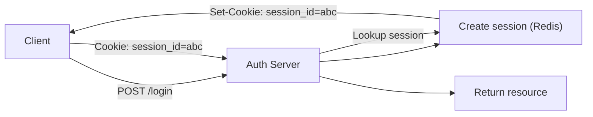
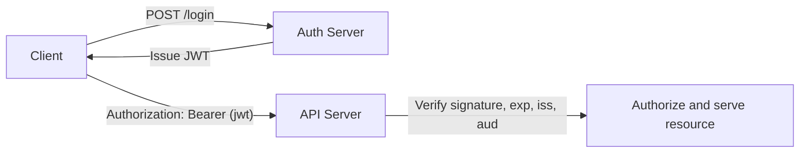
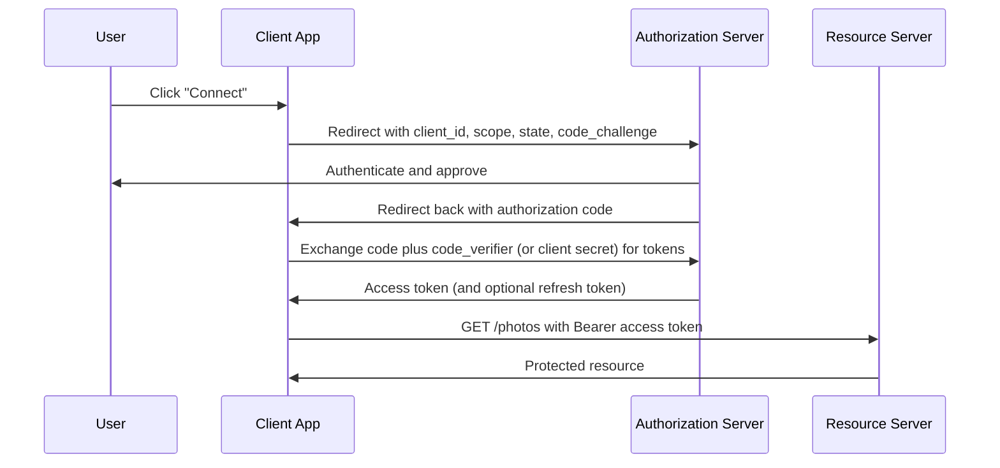
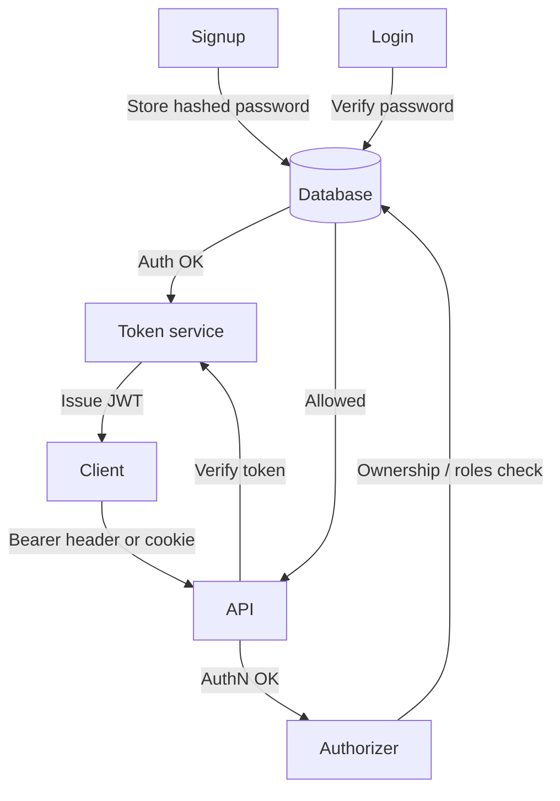

# Authentication And Authorization Explained: From Basics to Backend Engineering

A concise, engineer-focused reference covering **authentication**, **sessions**, **JWT**, **cookies**, **OAuth 2.0 / OIDC**, **authorization**, common security pitfalls, and practical FastAPI examples.

---

## Quick summary

| Concept | One-line meaning |
|---|---|
| **Authentication (AuthN)** | Verifies *who you are*. |
| **Session management** | How the app *remembers* you across requests. |
| **Authorization (AuthZ)** | What you are *allowed to do*. |

Rules of thumb:

- **Browser apps (server-rendered)** → server-side sessions in an HttpOnly cookie.
- **APIs, mobile apps, microservices** → short-lived JWT access tokens (plus a refresh/revocation plan).
- **"Sign in with Google/GitHub/..."** → OpenID Connect (OIDC).
- **Letting a third-party app access your data** → OAuth 2.0.
- **Never build your own crypto or your own OAuth server** if you can avoid it.

---

## Table of contents

1. [Big picture](#1-big-picture)
2. [Historical stages](#2-historical-stages)
3. [Sessions (server-side)](#3-sessions-server-side)
4. [JWT (token-based)](#4-jwt-token-based)
5. [Cookies](#5-cookies)
6. [Stateful vs stateless](#6-stateful-vs-stateless)
7. [OAuth 2.0](#7-oauth-20)
8. [OpenID Connect (OIDC)](#8-openid-connect-oidc)
9. [Authorization (ownership and RBAC)](#9-authorization-ownership-and-rbac)
10. [Error messages and timing attacks](#10-error-messages-and-timing-attacks)
11. [Additional protections](#11-additional-protections)
12. [Practical FastAPI example](#12-practical-fastapi-example)
13. [Full flow](#13-full-flow)
14. [Checklist: 10 things to remember](#14-checklist-10-things-to-remember)
15. [Common pitfalls and interview questions](#15-common-pitfalls-and-interview-questions)

---

## 1. Big picture

For every request, ask three questions:

1. **Authentication**: Who are you?
2. **Session management**: How do we remember you?
3. **Authorization**: Can you do this action on this resource?

They are related but distinct steps in request handling. Many security bugs come from mixing them up (for example, assuming "logged in" means "allowed").

---

## 2. Historical stages

- **Stage 1**: Username/password only. HTTP is stateless, so you would have to send credentials on every request.
- **Stage 2**: Server-side sessions to remember logged-in users.
- **Stage 3**: Cookies to carry the session ID automatically in browsers.
- **Stage 4**: Tokens (JWT) for self-contained claims and non-browser API clients.
- **Stage 5**: OAuth 2.0 / OIDC for delegated access and federated sign-in.

---

## 3. Sessions (server-side)

**Flow**

1. `POST /login`: the server verifies the password.
2. The server creates a session record and issues a random session ID in an **HttpOnly cookie**.
3. Later requests automatically include the cookie.
4. The server looks up the session and identifies the user.



**Merits**

- **Immediate revocation**: delete the session and the user is logged out.
- Sensitive state stays on the server.

**Costs**

- A session store is required (Redis, database).
- One lookup per request.

**Tips**

- Use **Redis** for a fast, scalable session store.
- Session IDs must be random and long (at least 128 bits from a cryptographically secure generator).
- **Regenerate the session ID on login** to prevent *session fixation* (an attacker planting a known session ID before the victim logs in).
- On logout, delete the session server-side, not just the cookie.
- Set an idle timeout and an absolute timeout.

---

## 4. JWT (token-based)

- Structure: `HEADER.PAYLOAD.SIGNATURE` (each part Base64URL-encoded).
- The payload contains **claims**, such as:
  - `sub`: subject (user ID)
  - `exp`: expiry time
  - `iat`: issued at
  - `iss`: issuer
  - `aud`: audience (who the token is meant for)
- The signature proves integrity (HMAC, RSA, or ECDSA). It does **not** hide the content.
- A JWT is **encoded, not encrypted**. Anyone holding it can read the payload, so never put secrets in it.

**Pros**

- Stateless validation: no store lookup needed.
- Convenient for mobile apps and microservices.

**Cons**

- Hard to revoke instantly unless you keep a denylist or version counter.
- Must be short-lived, and usually paired with refresh tokens.



**Signing keys**

- Use strong, random keys and rotate them.
- **HS256** (symmetric): one shared secret signs *and* verifies. Fine when a single service does both.
- **RS256 / ES256** (asymmetric): a private key signs, a public key verifies. Prefer this when many services verify tokens but only one issues them.
- Always pin the allowed algorithm(s) when verifying. Never let the token's own header decide.

---

## 5. Cookies

A cookie is a small piece of data the browser stores and automatically sends back to the server. It can hold a session ID or a JWT.

**Security attributes**

| Attribute | Purpose |
|---|---|
| `HttpOnly` | JavaScript cannot read the cookie (limits damage from XSS). |
| `Secure` | Sent only over HTTPS. |
| `SameSite` | Limits cross-site sending (`Strict`, `Lax`, or `None`). Helps against CSRF. |
| `Domain` / `Path` | Controls which requests include the cookie. |
| `Max-Age` / `Expires` | Lifetime. |

Example header:

```
Set-Cookie: session_id=abc123; HttpOnly; Secure; SameSite=Lax; Path=/; Max-Age=3600
```

**Notes**

- Because browsers send cookies automatically, state-changing requests need **CSRF protection**. `SameSite` helps but is not a complete defense; add CSRF tokens for sensitive actions.
- If you authenticate with an `Authorization` header instead, the browser does not attach it automatically, so classic CSRF does not apply (but you must store the token somewhere, see the pitfalls section).

---

## 6. Stateful vs stateless

| | Stateful (sessions) | Stateless (JWT) |
|---|---|---|
| Where is state? | Server store | Inside the token |
| Revocation | Easy | Hard (needs denylist or short expiry) |
| Per-request cost | Store lookup | Signature check |
| Needs central store? | Yes | No |

**When to use which**

- Browser + server-rendered pages, or a first-party SPA on the same site → **sessions + secure cookies** (simplest and safest).
- Public APIs, mobile apps, service-to-service → **JWTs** with a refresh/revocation plan.

Many real systems mix both: a short-lived JWT inside an HttpOnly cookie, backed by a server-side refresh token.

---

## 7. OAuth 2.0

- Purpose: **delegated authorization** ("let this app access my photos"), *not* login.
- Actors:
  - **Resource Owner**: the user
  - **Client**: the third-party app
  - **Authorization Server**: issues tokens
  - **Resource Server**: the API holding the data
- Common flow: **authorization code** → exchange the code for tokens → call the API with the access token.



**Notes**

- Use **PKCE** for public clients (mobile apps, SPAs), which cannot keep a secret. It is now recommended for all clients.
- Always send and verify the `state` parameter to prevent CSRF on the redirect.
- Confidential clients (server-side apps) can also authenticate with a client secret.
- Do not invent your own OAuth implementation. Use a well-tested library or provider.

---

## 8. OpenID Connect (OIDC)

- Built **on top of** OAuth 2.0.
- Adds an **ID token** (a JWT) that tells the client *who the user is*.
- ID token claims include `iss`, `sub`, `aud`, `exp`, `iat`, and often `nonce`.
- Use OIDC to implement "Sign in with <provider>".
- The ID token is for the **client app**. Use the **access token**, not the ID token, to call APIs.

**Difference in one line**

- **OAuth 2.0** = delegated access ("what can this app do?").
- **OIDC** = authentication ("who is this user?").

---

## 9. Authorization (ownership and RBAC)

- **Authentication** proves identity.
- **Authorization** decides which actions and data that identity may access.

**Principles**

- Always take the user identity from the **validated credential** (session or token), never from a client-supplied `user_id`.
- Enforce ownership **inside the database query**:

```sql
SELECT id, user_id, path
FROM image_metadata
WHERE id = :image_id
  AND user_id = :current_user_id;
```

- If no row comes back, return `404 Not Found` (or `403 Forbidden`). Returning 404 avoids revealing that someone else's resource exists.
- Use **role checks (RBAC)** for coarse rules ("admins only") and **ownership checks** for per-resource rules ("only my images").
- Failing to check ownership is called **IDOR / BOLA** (Insecure Direct Object Reference / Broken Object Level Authorization), one of the most common API vulnerabilities.

**FastAPI pattern**

1. A dependency (`get_current_user_id`) extracts the user ID from the validated credential.
2. The route passes that ID into a query that includes the `user_id` condition.

---

## 10. Error messages and timing attacks

- Use **generic login errors** to prevent username enumeration:
  - Return `401 Unauthorized` with "Invalid username or password" for both unknown user and wrong password.
- **Timing attack**: if "user not found" returns much faster than "wrong password" (because hashing is skipped), an attacker can tell which usernames exist. Fix: when the user does not exist, still verify against a **dummy hash**.
- **Rate-limit** authentication endpoints and monitor for brute force.

```python
from pwdlib import PasswordHash

password_hash = PasswordHash.recommended()  # Argon2 by default
DUMMY_HASH = password_hash.hash("dummy-password")  # generate once at startup


def authenticate(username: str, supplied_password: str):
    user = db.get_user_by_username(username)  # db is your data layer
    if user is not None:
        valid = password_hash.verify(supplied_password, user.hashed_password)
    else:
        # Spend roughly the same time even when the user does not exist
        password_hash.verify(supplied_password, DUMMY_HASH)
        valid = False
    return user if valid else None
```

> This reduces the timing signal but does not remove every difference (database lookup time, for example), so keep rate limiting too.

---

## 11. Additional protections

- Always use **HTTPS** in production.
- Store **password hashes** with a slow, salted algorithm: **Argon2id** (preferred), bcrypt, or scrypt. Never store plain or fast-hashed (MD5/SHA-256) passwords.
- Keep signing keys in a secret store (environment variable, vault), never in source code.
- Validate every token: **signature, `exp`, `iss`, `aud`**, and the expected algorithm.
- Use **short-lived access tokens** (minutes) plus **refresh tokens** with rotation and revocation.
- Use **CSRF protection** whenever authentication relies on cookies.
- Implement **rate limiting** and alerting on auth endpoints.
- For distributed JWT revocation, keep a **denylist in Redis** with a TTL equal to the token's remaining lifetime.

---

## 12. Practical FastAPI example

A compact example covering password hashing, token creation, token validation, a "current user" dependency, and an HttpOnly cookie login.

Install:

```bash
pip install fastapi uvicorn pyjwt "pwdlib[argon2]"
```

```python
# file: auth.py
import os
from datetime import datetime, timedelta, timezone
from typing import Optional

import jwt  # PyJWT
from fastapi import Depends, HTTPException, Request, status
from fastapi.security import HTTPAuthorizationCredentials, HTTPBearer
from pwdlib import PasswordHash

# --- Config: load from the environment, never hardcode secrets ---
SECRET_KEY = os.environ["JWT_SECRET_KEY"]  # e.g. output of: openssl rand -hex 32
ALGORITHM = "HS256"
ISSUER = "my-api"
AUDIENCE = "my-api-clients"
ACCESS_TOKEN_EXPIRE_MINUTES = 15

password_hash = PasswordHash.recommended()
bearer_scheme = HTTPBearer(auto_error=False)  # we also accept a cookie


# --- Password helpers ---
def hash_password(password: str) -> str:
    return password_hash.hash(password)


def verify_password(plain: str, hashed: str) -> bool:
    return password_hash.verify(plain, hashed)


# --- Token helpers ---
def create_access_token(subject: int, expires_delta: Optional[timedelta] = None) -> str:
    now = datetime.now(timezone.utc)  # timezone-aware; utcnow() is deprecated
    payload = {
        "sub": str(subject),
        "iat": now,
        "exp": now + (expires_delta or timedelta(minutes=ACCESS_TOKEN_EXPIRE_MINUTES)),
        "iss": ISSUER,
        "aud": AUDIENCE,
    }
    return jwt.encode(payload, SECRET_KEY, algorithm=ALGORITHM)


def decode_token(token: str) -> dict:
    try:
        return jwt.decode(
            token,
            SECRET_KEY,
            algorithms=[ALGORITHM],  # pin the algorithm
            audience=AUDIENCE,
            issuer=ISSUER,
            options={"require": ["exp", "sub", "iss", "aud"]},
        )
    except jwt.InvalidTokenError:
        raise HTTPException(
            status_code=status.HTTP_401_UNAUTHORIZED,
            detail="Invalid or expired token",
            headers={"WWW-Authenticate": "Bearer"},
        )


# --- Dependency: accepts "Authorization: Bearer <jwt>" OR the access_token cookie ---
def get_current_user_id(
    request: Request,
    credentials: Optional[HTTPAuthorizationCredentials] = Depends(bearer_scheme),
) -> int:
    token = credentials.credentials if credentials else request.cookies.get("access_token")
    if not token:
        raise HTTPException(status_code=401, detail="Not authenticated")
    payload = decode_token(token)
    try:
        return int(payload["sub"])
    except (KeyError, ValueError):
        raise HTTPException(status_code=401, detail="Invalid token payload")
```

```python
# file: main.py
from fastapi import Depends, FastAPI, HTTPException, Response
from pydantic import BaseModel

from auth import (ACCESS_TOKEN_EXPIRE_MINUTES, create_access_token,
                  get_current_user_id)

app = FastAPI()


class LoginRequest(BaseModel):
    username: str
    password: str


@app.post("/login")
def login(body: LoginRequest, response: Response):
    user = authenticate(body.username, body.password)  # see section 10
    if user is None:
        raise HTTPException(status_code=401, detail="Invalid username or password")

    token = create_access_token(subject=user.id)

    # Browser flow: HttpOnly cookie. API clients can use the returned token instead.
    response.set_cookie(
        key="access_token",
        value=token,
        httponly=True,
        secure=True,        # HTTPS only
        samesite="lax",
        max_age=ACCESS_TOKEN_EXPIRE_MINUTES * 60,
        path="/",
    )
    return {"access_token": token, "token_type": "bearer"}


@app.get("/images/{image_id}")
def get_image(image_id: int, user_id: int = Depends(get_current_user_id)):
    # Ownership check lives in the query (see section 9)
    row = db.fetch_image(image_id=image_id, user_id=user_id)
    if row is None:
        raise HTTPException(status_code=404, detail="Not found")
    return row
```

> If you rely on the cookie for browser sessions, add CSRF protection to state-changing routes (POST/PUT/PATCH/DELETE).

**Refresh token pattern (summary)**

- Issue a short-lived **access token** and a long-lived, random **refresh token**.
- Store only a **hash** of the refresh token server-side, along with its owner and expiry.
- On `/refresh`: validate the refresh token, **rotate** it (issue a new one, invalidate the old one), and return a new access token.
- If an *already-used* refresh token shows up again, treat it as theft and revoke that whole token family.

---

## 13. Full flow



---

## 14. Checklist: 10 things to remember

1. **Authentication** verifies identity.
2. A **session** keeps state across requests.
3. A **cookie** is only a transport mechanism (it can carry a session ID or a JWT).
4. A **JWT** carries signed (not encrypted) claims.
5. **Stateful** auth stores state on the server.
6. **Stateless** auth validates tokens without a session lookup.
7. **OAuth 2.0** = delegated access.
8. **OIDC** = authentication built on OAuth 2.0.
9. **Authorization** enforces access to each resource (check ownership in the query).
10. **Timing attacks and brute force**: generic errors, dummy-hash verification, and rate limiting.

---

## 15. Common pitfalls and interview questions

**Pitfalls**

- Storing JWTs in `localStorage`: any XSS bug can steal them. For browsers, prefer HttpOnly cookies (and add CSRF protection).
- Long-lived JWTs with no revocation: a stolen token stays valid until it expires.
- Trusting a client-provided `user_id` for authorization.
- Not validating `exp`, `iss`, `aud`, or the algorithm.
- Hardcoding the signing secret in source code.
- Reusing the same session ID after login (session fixation).
- Treating the OIDC ID token as an API access token.

**Interview questions**

- **How do you revoke JWTs?**
  Short-lived access tokens, refresh-token rotation, and a server-side denylist (Redis with TTL) or a per-user token version stored in the database.
- **Cookie vs Authorization header?**
  Cookies are sent automatically by browsers, so they need CSRF protection but can be HttpOnly. The Authorization header is explicit, common for API clients, and not vulnerable to classic CSRF, but the token must be stored where JavaScript can reach it.
- **How do you prevent username enumeration?**
  Generic error messages, consistent timing (dummy-hash verification), and rate limiting.
- **OAuth vs OIDC?**
  OAuth 2.0 grants an app limited access to resources. OIDC adds an ID token so the app learns who the user is.
- **Why PKCE?**
  Public clients cannot keep a secret. PKCE binds the authorization code to the client that started the flow, so a stolen code is useless.
- **Authentication vs authorization?**
  Authentication answers "who are you?", authorization answers "what may you do?".
