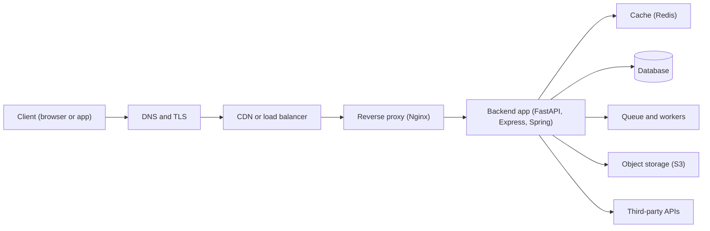
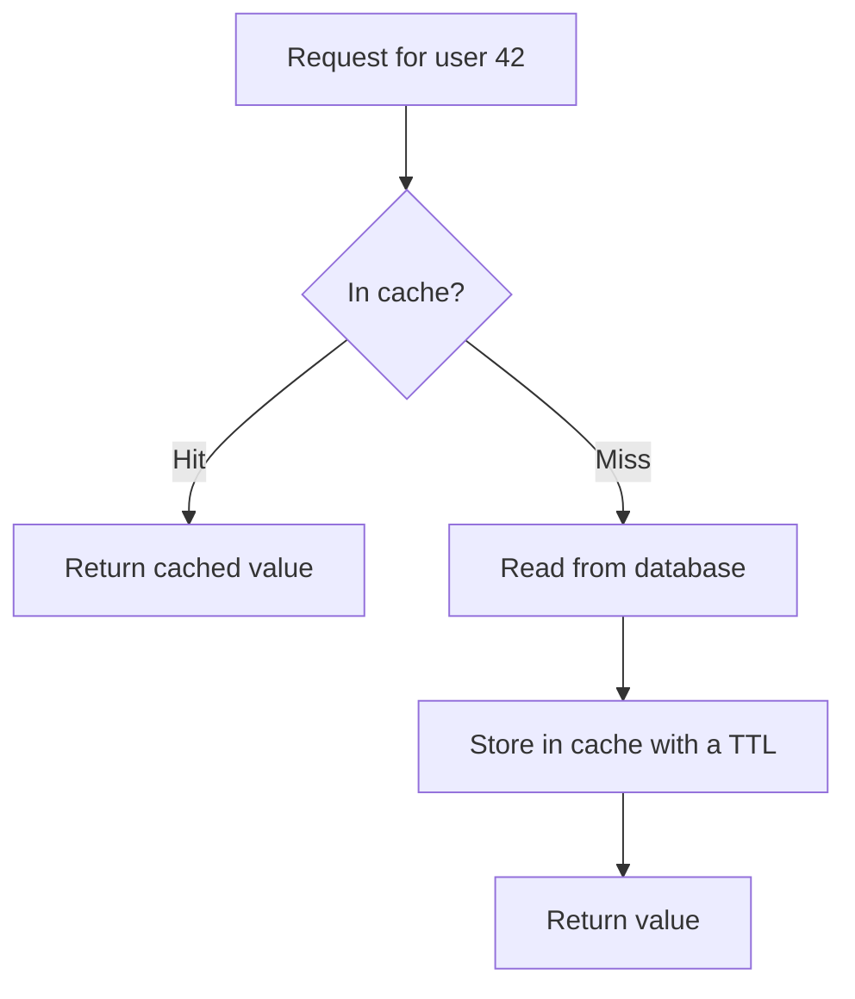
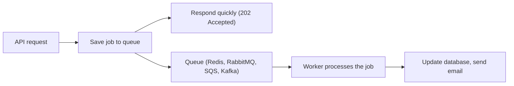

# Introduction to Backend Development: Everything You Need to Know

A beginner-to-engineer map of backend development: what a backend does, the building blocks (APIs, databases, auth, caching, queues, storage), how to structure, secure, test, deploy and scale it, and a roadmap for learning it. Each area is short on purpose. Use it as the "big picture" and dive deeper into each topic later.

---

## Quick summary

- **Backend** = the part of an application users never see: it receives requests, applies business rules, talks to databases and other services, and returns responses.
- **Frontend** = what users see and click. The frontend asks, the backend decides and stores.
- The core building blocks are: **language + framework**, **APIs**, **database**, **authentication and authorization**, **caching**, **background jobs**, **file storage**.
- Around them you need: **architecture**, **security**, **testing**, **observability**, **deployment (DevOps)**.
- Good backend engineering is mostly about **correctness, security, reliability, and keeping things simple**. Performance and scale come after that.

---

## Table of contents

1. [What is backend development](#1-what-is-backend-development)
2. [The request lifecycle](#2-the-request-lifecycle)
3. [Internet and networking basics](#3-internet-and-networking-basics)
4. [Languages and frameworks](#4-languages-and-frameworks)
5. [APIs](#5-apis)
6. [Databases](#6-databases)
7. [Authentication and authorization](#7-authentication-and-authorization)
8. [Caching](#8-caching)
9. [Background jobs and queues](#9-background-jobs-and-queues)
10. [File storage](#10-file-storage)
11. [Application architecture](#11-application-architecture)
12. [Concurrency](#12-concurrency)
13. [Scalability and performance](#13-scalability-and-performance)
14. [Reliability and observability](#14-reliability-and-observability)
15. [Security](#15-security)
16. [Testing](#16-testing)
17. [Git and collaboration](#17-git-and-collaboration)
18. [DevOps basics](#18-devops-basics)
19. [Configuration and environments](#19-configuration-and-environments)
20. [Learning roadmap](#20-learning-roadmap)
21. [Checklist: things to remember](#21-checklist-things-to-remember)
22. [Common pitfalls and interview questions](#22-common-pitfalls-and-interview-questions)

---

## 1. What is backend development

**Frontend** and **backend** split the work of an application:

| | Frontend | Backend |
|---|---|---|
| Runs on | User's browser or phone | Servers (your machines or the cloud) |
| Job | Show things, collect input | Store data, enforce rules, keep things secure |
| Typical tech | HTML, CSS, JavaScript, React, Swift, Kotlin | Python, Node.js, Java, Go, C#, SQL, Redis |
| Can the user tamper with it? | **Yes** (they control their device) | No (you control the server) |

That last row is the key rule of backend work: **never trust the client.** Anything the frontend does (validation, hiding buttons, price calculations) must be **re-checked on the backend**.

**What a backend is responsible for**

- Receiving and answering requests (APIs)
- Storing and retrieving data (databases)
- Business logic ("an order cannot be cancelled after it ships")
- Identity and permissions (authentication and authorization)
- Talking to other systems (payments, email, SMS, third-party APIs)
- Running slow work in the background (emails, reports, video processing)
- Staying fast, available, secure, and observable

---

## 2. The request lifecycle

What happens between "user clicks a button" and "page updates":



Inside the backend app, one request usually goes through these steps:

1. **Routing**: match the URL and method (`POST /tasks`) to a handler.
2. **Middleware**: logging, CORS, rate limiting, authentication.
3. **Validation**: check the input shape and types.
4. **Authorization**: is this user allowed to do this?
5. **Business logic**: apply the rules.
6. **Data access**: read or write the database (and cache).
7. **Response**: serialize to JSON, set the status code and headers.

---

## 3. Internet and networking basics

You do not need to be a network engineer, but you must know the vocabulary:

- **Client-server model**: clients ask, servers answer.
- **IP address**: the address of a machine. **Port**: the "door" on that machine (80 HTTP, 443 HTTPS, 5432 PostgreSQL, 6379 Redis).
- **DNS**: the phone book that turns `example.com` into an IP address.
- **TCP**: reliable, ordered delivery. **UDP**: fast, no guarantees (used by QUIC / HTTP/3, video calls, DNS).
- **HTTP / HTTPS**: the language of the web (see the [HTTP and HTTPS guide](http-https-guide.md)).
- **Proxy / reverse proxy**: a middleman. A reverse proxy (Nginx, Caddy) sits in front of your app for TLS, compression, caching and load balancing.
- **Load balancer**: spreads traffic across several copies of your app.
- **CDN**: servers around the world that cache static content near users.
- **Localhost** (`127.0.0.1`): your own machine, used while developing.

Useful commands: `curl`, `ping`, `dig` / `nslookup`, `ss -tulpn` (what is listening on which port), `traceroute`.

---

## 4. Languages and frameworks

A **language** is the tool. A **framework** gives you routing, validation, and structure so you do not rebuild everything.

| Language | Popular frameworks | Good for |
|---|---|---|
| **Python** | FastAPI, Django, Flask | Fast development, APIs, data/AI, scripting |
| **JavaScript / TypeScript** | Express, NestJS, Fastify | Same language as the frontend, large ecosystem |
| **Java / Kotlin** | Spring Boot | Large enterprise systems |
| **Go** | Gin, Echo, standard library | High performance, simple deployment |
| **C#** | ASP.NET Core | Enterprise, Microsoft ecosystem |
| **Ruby** | Rails | Rapid product development |
| **PHP** | Laravel | Web apps, huge hosting support |
| **Rust** | Axum, Actix | Maximum performance and safety |

**How to choose**

- Pick **one** language and learn it deeply. Concepts transfer between languages. Syntax does not matter as much as you think.
- Choose based on your goal, job market, team, and ecosystem, not hype.
- Django = "batteries included" (admin, ORM, auth). FastAPI = lightweight, modern, great docs and type hints. Flask/Express = minimal, you choose the pieces.

**A tiny backend (FastAPI)**

```python
# file: main.py   (run: uvicorn main:app --reload)
from fastapi import FastAPI, HTTPException, status
from pydantic import BaseModel, Field

app = FastAPI()


class TaskIn(BaseModel):
    title: str = Field(min_length=1, max_length=100)   # validation


class TaskOut(TaskIn):
    id: int
    done: bool = False


tasks: dict[int, TaskOut] = {}   # in-memory for learning, use a database for real apps
next_id = 1


@app.post("/tasks", response_model=TaskOut, status_code=status.HTTP_201_CREATED)
def create_task(body: TaskIn):
    global next_id
    task = TaskOut(id=next_id, title=body.title)
    tasks[next_id] = task
    next_id += 1
    return task


@app.get("/tasks/{task_id}", response_model=TaskOut)
def get_task(task_id: int):
    task = tasks.get(task_id)
    if task is None:
        raise HTTPException(status_code=404, detail="Task not found")
    return task
```

Open `http://localhost:8000/docs` for automatic interactive API documentation.

---

## 5. APIs

An **API** (Application Programming Interface) is how programs talk to your backend.

### API styles

| Style | Idea | Use when |
|---|---|---|
| **REST** | Resources as URLs, standard HTTP methods, JSON | Default for most web and mobile APIs |
| **GraphQL** | One endpoint, client chooses exactly which fields it wants | Many different clients with different data needs |
| **gRPC** | Binary (Protocol Buffers) over HTTP/2, strict contracts | Fast service-to-service calls |
| **WebSockets** | Persistent two-way connection | Chat, live dashboards, games |
| **Server-Sent Events** | Server pushes updates one way | Notifications, live feeds, streaming text |
| **Webhooks** | Server calls *your* URL when something happens | Payment confirmed, GitHub push |

### REST design rules

- **Use nouns, not verbs**, usually plural: `/users`, `/users/42/orders`. Not `/getUser` or `/createOrder`.
- **Let the HTTP method be the verb**: `GET` read, `POST` create, `PUT` replace, `PATCH` update, `DELETE` remove.
- **Use proper status codes**: `201` created, `204` no content, `400/422` bad input, `401` not logged in, `403` not allowed, `404` not found, `409` conflict, `429` rate limited.
- **Version your API**: `/v1/...` so you can change things without breaking old clients.
- **Paginate lists**: never return 1,000,000 rows.
  - *Offset*: `?limit=20&offset=40` (simple, slows down on large tables).
  - *Cursor*: `?limit=20&after=abc123` (stable and fast for big or changing data).
- **Filter and sort** through query params: `?status=done&sort=-created_at`.
- **Keep error responses consistent**:

```json
{
  "error": {
    "code": "validation_error",
    "message": "title must not be empty",
    "field": "title"
  }
}
```

- **Make unsafe retries safe** with idempotency keys for payments and orders (see the HTTP guide).
- **Document with OpenAPI / Swagger** (FastAPI generates it for you).
- Return only the fields the client needs. Never leak password hashes, internal IDs, or stack traces.

### Data formats

- **JSON**: the default. **Protobuf**: compact binary (gRPC). **CSV**: tabular exports. **XML**: legacy systems.
- **Validate input and serialize output** with a schema library (Pydantic in Python, Zod in TypeScript, etc.).

---

## 6. Databases

Almost every backend stores data. Choose and use the database carefully, since the data usually outlives the code.

### Relational (SQL) vs NoSQL

| | Relational (SQL) | NoSQL |
|---|---|---|
| Examples | **PostgreSQL**, MySQL, SQLite | MongoDB (document), Redis (key-value), Cassandra (wide-column), Neo4j (graph) |
| Structure | Tables, rows, fixed schema, relationships | Flexible, depends on the type |
| Strengths | Joins, constraints, transactions, mature tooling | Flexible schema, easy horizontal scaling for certain workloads |
| Default choice? | **Yes, start here (PostgreSQL)** | When you have a clear need |

### SQL essentials

```sql
-- Create tables with constraints
CREATE TABLE users (
  id         SERIAL PRIMARY KEY,
  email      TEXT NOT NULL UNIQUE,
  created_at TIMESTAMPTZ NOT NULL DEFAULT now()
);

CREATE TABLE tasks (
  id      SERIAL PRIMARY KEY,
  user_id INT NOT NULL REFERENCES users(id) ON DELETE CASCADE,
  title   TEXT NOT NULL,
  done    BOOLEAN NOT NULL DEFAULT false
);

-- Read with a join
SELECT u.email, t.title
FROM tasks t
JOIN users u ON u.id = t.user_id
WHERE t.done = false
ORDER BY t.id DESC
LIMIT 20;

-- Speed up a frequent lookup
CREATE INDEX idx_tasks_user_id ON tasks(user_id);
```

Always use **parameterized queries** (`WHERE id = :id`), never string concatenation, to prevent SQL injection.

### Key concepts

- **Primary key**: unique ID of a row. **Foreign key**: a link to a row in another table.
- **Normalization**: store each fact once to avoid inconsistent duplicates. Denormalize deliberately for speed.
- **Indexes**: make reads fast (like a book index) but slow down writes and use space. Index columns you filter, join, or sort on. Use `EXPLAIN` to see whether a query uses an index.
- **Transactions**: a group of operations that succeed or fail **together** (transfer money: subtract from A *and* add to B, or do nothing).
- **ACID**: **A**tomicity (all or nothing), **C**onsistency (rules always hold), **I**solation (concurrent transactions do not corrupt each other), **D**urability (committed data survives crashes).
- **Migrations**: versioned scripts that change the schema (Alembic, Flyway, Prisma, Django migrations). Never edit production tables by hand.
- **ORM** (SQLAlchemy, Django ORM, Prisma, Hibernate): maps tables to objects. Convenient, but learn SQL anyway so you can spot slow queries.
- **N+1 problem**: loading 100 tasks and then running 100 extra queries to get each task's user. Fix with joins or eager loading.
- **Connection pooling**: reuse database connections instead of opening a new one per request (opening is expensive, and databases have connection limits).
- **Backups and restore tests**: a backup you have never restored is only a hope.
- **Soft delete** (`deleted_at` column) vs hard delete: soft delete helps recovery but complicates queries.

### Scaling the database (later)

- **Read replicas**: copies for reading. Beware **replication lag** (a read right after a write might show old data).
- **Partitioning / sharding**: split big tables or data across machines.
- **CAP idea**: when a network partition happens, a distributed system has to choose between consistency and availability.

---

## 7. Authentication and authorization

- **Authentication**: who are you? (passwords, sessions, JWT, OAuth, OIDC)
- **Authorization**: what are you allowed to do? (roles, ownership checks)

The full explanation, with diagrams and a FastAPI example, is in the [Authentication and Authorization guide](authentication-guide.md). The essentials:

- Hash passwords with **Argon2id** (or bcrypt). Never store plain text.
- Browser apps: **server-side sessions** in an HttpOnly cookie. APIs and mobile: **short-lived JWT access tokens** plus refresh tokens.
- Derive the user from the **validated credential**, never from a client-supplied `user_id`.
- Enforce **ownership in the database query** (`WHERE id = :id AND user_id = :current_user`).

---

## 8. Caching

**Caching** = keep a copy of expensive results somewhere faster.

| Layer | Example | Caches |
|---|---|---|
| Browser | `Cache-Control`, `ETag` | Static files, API responses |
| CDN | Cloudflare, CloudFront | Images, JS, CSS, public pages |
| Application | **Redis**, Memcached | Query results, computed data, sessions |
| Database | Query planner, buffer cache | Hot data pages |

**Cache-aside** (the most common pattern):



```python
def get_user(user_id: int):
    key = f"user:{user_id}"
    cached = redis.get(key)
    if cached:
        return json.loads(cached)
    user = db.fetch_user(user_id)
    redis.setex(key, 300, json.dumps(user))   # expire after 5 minutes
    return user
```

**Remember**

- Cache invalidation is the hard part: when data changes, delete or update the cached copy (or accept a short TTL).
- Always set a **TTL** (time to live).
- Do not cache private data in shared caches.
- **Cache stampede**: when a popular key expires and thousands of requests hit the database at once. Mitigate with locks, jittered TTLs, or refreshing early.
- Only add a cache when you have measured a real problem. It adds complexity.

HTTP-level caching is covered in the [HTTP and HTTPS guide](http-https-guide.md).

---

## 9. Background jobs and queues

Do not make users wait for slow work. Accept the request, put a job on a **queue**, and let a **worker** process it later.



**Good fits**: sending email/SMS, image or video processing, report generation, webhooks, data imports, calling slow third-party APIs, scheduled jobs (cron).

**Tools**: Celery, RQ, Dramatiq (Python), BullMQ (Node), Sidekiq (Ruby). **Brokers**: Redis, RabbitMQ, Amazon SQS, Kafka.

| Concept | Meaning |
|---|---|
| **Queue** | Each message is handled by one worker |
| **Pub/Sub** | Each message goes to all subscribers |
| **Kafka** | A durable, replayable event log for high-volume streaming |

**Rules for reliable jobs**

- Delivery is usually **at-least-once**, so a job can run twice. Make jobs **idempotent**.
- Use **retries with exponential backoff** and a **dead-letter queue** for jobs that keep failing.
- Set timeouts. Log job ids so you can trace them.

---

## 10. File storage

- **Do not store large files inside the database.** Use **object storage**: Amazon S3, Google Cloud Storage, Azure Blob, Cloudflare R2, or MinIO (self-hosted).
- Store the **file** in object storage and its **metadata** (owner, path, size, type) in the database.
- Use **pre-signed URLs** so clients upload or download directly from storage with a temporary link. This keeps large traffic off your server.
- Validate file **type, size, and name** on the server. Never trust the client-provided filename or content type.
- Serve public files through a **CDN**.
- Keep private files private and check authorization before generating a link.

---

## 11. Application architecture

### Layers (keep responsibilities separate)

```
Router / Controller   ->  handles HTTP: parse request, call service, return response
Service layer         ->  business rules ("can this order be cancelled?")
Repository / DAO      ->  talks to the database
Database
```

A typical project structure:

```
app/
├── main.py            # creates the app, registers routers
├── config.py          # settings from environment variables
├── routers/           # HTTP endpoints
├── services/          # business logic
├── repositories/      # database access
├── models/            # database models
├── schemas/           # request and response models (validation)
├── core/              # security, logging, shared utilities
└── tests/
```

### Monolith vs microservices

| | Monolith | Microservices |
|---|---|---|
| Deploy | One unit | Many small services |
| Complexity | Low | High (networking, data consistency, monitoring) |
| Best for | Most products, small teams, starting out | Large teams, parts that need to scale independently |

**Advice**: start with a **well-organized monolith**. Split into services only when you have a real reason.

### Useful principles

- **Separation of concerns**, **DRY** (do not repeat yourself), **KISS** (keep it simple), **YAGNI** (do not build what you do not need yet), **SOLID** for object-oriented design.
- **Stateless services**: keep no user state in app memory, so any instance can serve any request and you can run many copies.
- **Twelve-factor app**: config in environment variables, logs to stdout, disposable processes, dev/prod parity.
- **Dependency injection**: pass dependencies in (FastAPI's `Depends`) so code is easier to test.
- **Event-driven design**: services publish events ("order placed") and others react. This reduces coupling but makes flows harder to follow.
- **Design for failure**: networks, disks, and third parties will fail.

---

## 12. Concurrency

Servers handle many requests at once. Know the basic models:

| Model | Idea | Best for |
|---|---|---|
| **Multi-process** | Several OS processes | CPU-heavy work, using all cores |
| **Multi-thread** | Threads share memory | Mixed workloads (watch for race conditions) |
| **Async / event loop** | One thread switches tasks while waiting on I/O (`async/await`) | Many I/O-bound requests (database, HTTP calls) |

- **I/O-bound** (waiting for network or disk) → async or threads. **CPU-bound** (computing) → multiple processes or workers.
- In Python, the **GIL** has traditionally stopped threads from running Python code in parallel, which is why CPU-bound work uses processes. Production servers run several worker processes (e.g. Gunicorn or Uvicorn workers).
- **Never block the event loop** in async code (for example, a slow synchronous database call inside an `async def` handler).
- **Race conditions**: two requests changing the same data at once (e.g. both read stock = 1, both sell it). Prevent with database transactions, row locks, unique constraints, or atomic updates (`UPDATE ... SET stock = stock - 1 WHERE stock > 0`).

---

## 13. Scalability and performance

**Scalability** = handling more load by adding resources.

- **Vertical scaling**: a bigger machine. Simple, but has a limit.
- **Horizontal scaling**: more machines behind a **load balancer**. Needs stateless services.

**Typical order of optimization** (measure first!):

1. Fix slow queries and add **indexes**.
2. Fix **N+1** queries and add **pagination**.
3. Add **caching**.
4. Move slow work to **background jobs**.
5. Add **read replicas**, a **CDN**, and more app instances.
6. Only then think about sharding or microservices.

**Vocabulary**

- **Latency**: time for one request. **Throughput**: requests per second.
- **p50 / p95 / p99**: the median and the slow tail. Averages hide the pain of the slowest users.
- **Rate limiting**: protect your service by limiting requests per user or IP (return `429` with `Retry-After`). Common algorithms: token bucket, sliding window.
- **Timeouts**: always set them on outgoing calls. A missing timeout can take your whole system down.
- **Backpressure**: slow down or reject work when overloaded instead of falling over.

**Tools**: profilers, `EXPLAIN`, load testing (k6, Locust, wrk), and APM dashboards.

> Premature optimization is the root of many problems. Measure, find the bottleneck, fix that.

---

## 14. Reliability and observability

You cannot fix what you cannot see.

**The three pillars**

| Pillar | Question it answers | Tools |
|---|---|---|
| **Logs** | What happened? | Structured JSON logs, ELK/Loki, CloudWatch |
| **Metrics** | How is it doing? (rates, errors, latency) | Prometheus, Grafana, Datadog |
| **Traces** | Where did this request spend its time? | OpenTelemetry, Jaeger |

Plus **error tracking** (Sentry) and **alerts** on symptoms users feel (error rate, latency).

**Good habits**

- Log with **levels** (DEBUG, INFO, WARNING, ERROR) and a **request id** you can follow across services.
- Never log passwords, tokens, or personal data.
- Add **health check endpoints**: *liveness* ("is the process alive?") and *readiness* ("can it serve traffic? is the database reachable?").
- **Graceful shutdown**: finish in-flight requests before stopping.
- **Retries with exponential backoff and jitter** for transient failures, but only on idempotent operations.
- **Circuit breaker**: stop calling a failing dependency for a while instead of piling on.
- Handle errors centrally. Return a safe message to the user and log the details privately.
- Know your **SLO/SLA** targets (e.g. 99.9% availability), and practice **incident response** and **post-mortems** (blameless).

---

## 15. Security

Security is not a feature you add at the end. Core rules:

- **Never trust input.** Validate and sanitize everything (body, query, headers, files).
- **HTTPS everywhere** (see the HTTP and HTTPS guide).
- **Least privilege**: every user, service, and database account gets only the access it needs.
- **Keep secrets out of code and Git** (use environment variables or a secret manager). Rotate them.
- **Keep dependencies updated** and scan them for known vulnerabilities (Dependabot, `pip-audit`, `npm audit`).

**Common attacks** (the OWASP Top 10 lists the most common categories; check the latest version)

| Attack | What it is | Defense |
|---|---|---|
| **SQL injection** | Malicious input changes your SQL | Parameterized queries / ORM |
| **XSS** | Attacker script runs in other users' browsers | Escape output, Content-Security-Policy |
| **CSRF** | A malicious site makes the browser send authenticated requests | SameSite cookies, CSRF tokens |
| **Broken access control / IDOR** | Changing an id to read someone else's data | Ownership checks on every query |
| **SSRF** | Tricking your server into calling internal URLs | Allowlist outgoing URLs, block internal ranges |
| **Brute force / credential stuffing** | Guessing passwords | Rate limiting, lockouts, MFA |
| **Insecure deserialization / file upload** | Malicious payloads or files | Validate types, never execute uploads |
| **Misconfiguration** | Debug mode on, open ports, default passwords | Hardened defaults, reviews |

Other habits: log security events, use **MFA** for admin access, backup data, and run security reviews. Treat **authorization checks** as the number one source of real-world bugs.

---

## 16. Testing

Tests let you change code without fear.

**The test pyramid**

```
        /  End-to-end  \     few, slow, test the whole system
       /  Integration   \    some, test parts working together (API + database)
      /   Unit tests     \   many, fast, test one function or class
```

- **Unit tests**: small and fast, no network or database (mock external things).
- **Integration tests**: your API with a real test database.
- **End-to-end tests**: full flows through a real or staging environment.
- **Load tests** and **security tests** for non-functional needs.

**Practical tips**

- Tools: `pytest` + FastAPI `TestClient` (Python), Jest/Vitest (JS), JUnit (Java).
- Test **behavior**, including error cases and permissions (a user must not read someone else's data).
- Keep tests independent, repeatable, and fast. Use fixtures and a fresh test database.
- Run tests automatically in **CI** on every pull request.
- **TDD** (write the test first) is a useful tool, not a religion.

```python
from fastapi.testclient import TestClient
from main import app

client = TestClient(app)

def test_create_and_get_task():
    r = client.post("/tasks", json={"title": "Learn backend"})
    assert r.status_code == 201
    task_id = r.json()["id"]

    r = client.get(f"/tasks/{task_id}")
    assert r.status_code == 200
    assert r.json()["title"] == "Learn backend"

def test_missing_task_returns_404():
    assert client.get("/tasks/999999").status_code == 404
```

---

## 17. Git and collaboration

- **Git** tracks changes. **GitHub / GitLab / Bitbucket** host repositories and reviews.
- Daily commands: `git status`, `git add`, `git commit`, `git push`, `git pull`, `git switch -c feature/x`, `git merge`, `git rebase`, `git log`, `git stash`.
- **Workflow**: branch → commit small changes → open a **pull request** → code review → CI passes → merge.
- Write clear commit messages (e.g. "Add rate limiting to login endpoint").
- Add a `.gitignore` (never commit `.env`, secrets, `node_modules`, virtual environments).
- Write a good **README**: what the project is, how to run it, how to test it.
- **Code review** is for sharing knowledge and catching bugs. Be kind and specific.

---

## 18. DevOps basics

Getting code from your laptop to users, reliably.

**Linux and the command line**: `cd`, `ls`, `cat`, `grep`, `tail -f`, `chmod`, `ps`, `top`, `ssh`, `scp`, `systemd`, environment variables. Most servers run Linux.

**Docker**

- A **container** packages your app with everything it needs, so it runs the same everywhere.
- **Image** = the recipe/package. **Container** = a running instance.

```dockerfile
FROM python:3.12-slim
WORKDIR /app
COPY requirements.txt .
RUN pip install --no-cache-dir -r requirements.txt
COPY . .
CMD ["uvicorn", "main:app", "--host", "0.0.0.0", "--port", "8000"]
```

- **Docker Compose** runs several containers together (app + PostgreSQL + Redis) for local development.
- **Kubernetes** orchestrates many containers at scale. Learn it later, only if needed.

**CI/CD**

- **CI** (Continuous Integration): on every push, automatically lint, test, and build.
- **CD** (Continuous Delivery/Deployment): automatically deploy passing builds.
- Tools: GitHub Actions, GitLab CI, Jenkins.

**Cloud**

- Providers: AWS, Google Cloud, Azure (and simpler platforms like Render, Railway, Fly.io, Vercel).
- Core services to know: virtual machines (EC2), managed databases (RDS), object storage (S3), queues (SQS), load balancers, DNS, secret managers, serverless functions (Lambda).
- **Infrastructure as Code** (Terraform, Pulumi, CloudFormation): describe infrastructure in files that live in Git.

**Deployment strategies**

| Strategy | Idea |
|---|---|
| **Rolling** | Replace instances a few at a time |
| **Blue-green** | Run old and new side by side, switch traffic at once, easy rollback |
| **Canary** | Send a small share of traffic to the new version first |

Always have a **rollback plan**, and run **database migrations** in a backward-compatible way (add columns first, remove them later).

---

## 19. Configuration and environments

- Typical environments: **local → dev → staging → production**. Staging should look like production.
- Keep **config separate from code**: use **environment variables** (`DATABASE_URL`, `JWT_SECRET_KEY`).
- `.env` files are fine for local development, but **never commit them**.
- In production, use a **secret manager** (AWS Secrets Manager, HashiCorp Vault, your platform's secrets).
- Validate configuration at startup and **fail fast** if something is missing.

```python
# config.py
import os

DATABASE_URL = os.environ["DATABASE_URL"]          # crash early if missing
DEBUG = os.getenv("DEBUG", "false").lower() == "true"
```

- Use **feature flags** to turn features on or off without redeploying.
- Never run production with `DEBUG=true`.

---

## 20. Learning roadmap

A sensible order:

1. **One programming language** (Python or JavaScript/TypeScript are great starts): data structures, functions, classes, error handling.
2. **Command line + Git.**
3. **How the web works**: HTTP, HTTPS, DNS (read the [HTTP and HTTPS guide](http-https-guide.md)).
4. **SQL and a relational database** (PostgreSQL).
5. **A framework**: build a CRUD REST API with validation (FastAPI, Express, Spring...).
6. **Authentication and authorization** (read the [Authentication and Authorization guide](authentication-guide.md)).
7. **Testing** and **clean structure** (layers).
8. **Caching (Redis)** and **background jobs**.
9. **Docker, CI/CD, and deploy something** to the cloud.
10. **Observability, security hardening, and system design** (scalability, trade-offs).
11. Go deeper: message brokers, microservices, Kubernetes, cloud services, performance tuning.

**Project ideas (in increasing difficulty)**

1. **To-do API**: CRUD, validation, PostgreSQL.
2. **URL shortener**: unique ids, redirects (`301`/`302`), caching, rate limiting.
3. **Blog or notes API**: users, login, ownership checks, pagination.
4. **Image upload service**: object storage, pre-signed URLs, metadata in the database.
5. **Job queue app**: background email/report generation with retries.
6. **Chat or live notifications**: WebSockets or Server-Sent Events.
7. **E-commerce backend**: orders, payments, transactions, idempotency keys, inventory race conditions.

Learn by **building and deploying**. Reading alone is not enough.

---

## 21. Checklist: things to remember

1. The backend **receives requests, applies rules, stores data, returns responses**.
2. **Never trust the client.** Validate and authorize on the server.
3. Learn **one language and framework** deeply first.
4. Design APIs with **nouns, correct methods, correct status codes, versions, and pagination**.
5. Start with **PostgreSQL**. Know **indexes, transactions, migrations, and the N+1 problem**.
6. Hash passwords (**Argon2id**), use **sessions or short-lived tokens**, and check **ownership in queries**.
7. **Cache** only measured problems, and always set a TTL.
8. Do slow work in **background jobs**. Make them **idempotent** with retries.
9. Keep files in **object storage**, not in the database.
10. Keep **layers separate** (router, service, repository). Start with a **monolith**.
11. Understand **async vs threads vs processes**, and **race conditions**.
12. **Measure** before optimizing: fix queries first, then cache, then scale out.
13. Use **logs, metrics, traces**, health checks, timeouts, and retries with backoff.
14. Secure by default: **parameterized queries, HTTPS, least privilege, secrets out of code, updated dependencies**.
15. **Test** (unit, integration) and run tests in **CI**.
16. Use **Git** with pull requests and code reviews.
17. Package with **Docker**, deploy with **CI/CD**, keep **config in environment variables**.
18. Always have **backups** (tested restores) and a **rollback plan**.

---

## 22. Common pitfalls and interview questions

**Pitfalls**

- Trusting the frontend for validation or permissions.
- Skipping **authorization** and **ownership checks** (the most common real-world bug).
- String-building SQL instead of using parameters.
- No indexes, no pagination, and N+1 queries.
- Doing slow work inside the request instead of a background job.
- Missing **timeouts** on outgoing calls.
- Committing secrets to Git.
- Returning `200 OK` with an error message in the body.
- Jumping to **microservices**, Kubernetes, or Kafka before you need them.
- Storing user state in server memory, which breaks horizontal scaling.
- Never testing backups, and no rollback plan.
- Logging sensitive data, and having no monitoring until something breaks.

**Interview questions**

- **What happens when you type a URL and press Enter?**
  DNS lookup, TCP/TLS connection, HTTP request through CDN/load balancer to the app, database/cache access, response back, browser renders.
- **REST vs GraphQL vs gRPC?**
  REST: simple resource-based JSON over HTTP, the default. GraphQL: client chooses fields, one endpoint, good for varied clients. gRPC: binary, strongly typed, fast, ideal between internal services.
- **SQL vs NoSQL?**
  SQL: structured data, relationships, transactions (ACID). NoSQL: flexible schemas or specific access patterns and scale. Start with SQL unless you have a clear reason.
- **What is an index, and what is its cost?**
  A data structure (usually a B-tree) that speeds up lookups. It costs extra storage and slows writes.
- **What is a database transaction and ACID?**
  A group of operations that succeed or fail together. ACID = atomicity, consistency, isolation, durability.
- **What is the N+1 query problem?**
  One query for a list plus one extra query per item. Fix with joins or eager loading.
- **How do you scale a backend?**
  Make it stateless, add instances behind a load balancer, cache, use read replicas, offload to queues, use a CDN. Measure first.
- **Monolith vs microservices?**
  A monolith is simpler to build and run. Microservices help large teams and independent scaling, but add network, consistency, and operational complexity.
- **Sessions vs JWT?**
  Sessions: server-side state, easy revocation. JWT: stateless, harder to revoke. See the Authentication guide.
- **How do you prevent duplicate payments on retries?**
  Idempotency keys: the server stores the result per key and returns the same response on a retry.
- **How do you handle a slow third-party API?**
  Timeouts, retries with backoff, circuit breaker, caching, and moving the call to a background job.
- **What is a race condition and how do you avoid it?**
  Concurrent operations interfering with each other. Use transactions, row locks, unique constraints, or atomic updates.
- **How do you make a system observable?**
  Structured logs, metrics, distributed traces, error tracking, and alerts.
- **What are the main security risks in a web backend?**
  Broken access control, injection, weak authentication, misconfiguration, vulnerable dependencies, SSRF, and leaked secrets.
- **What is CI/CD?**
  CI automatically builds and tests every change. CD automatically delivers passing builds to an environment.
