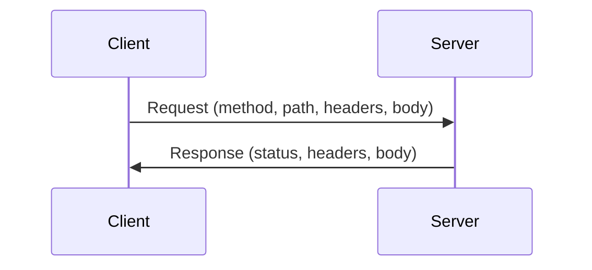
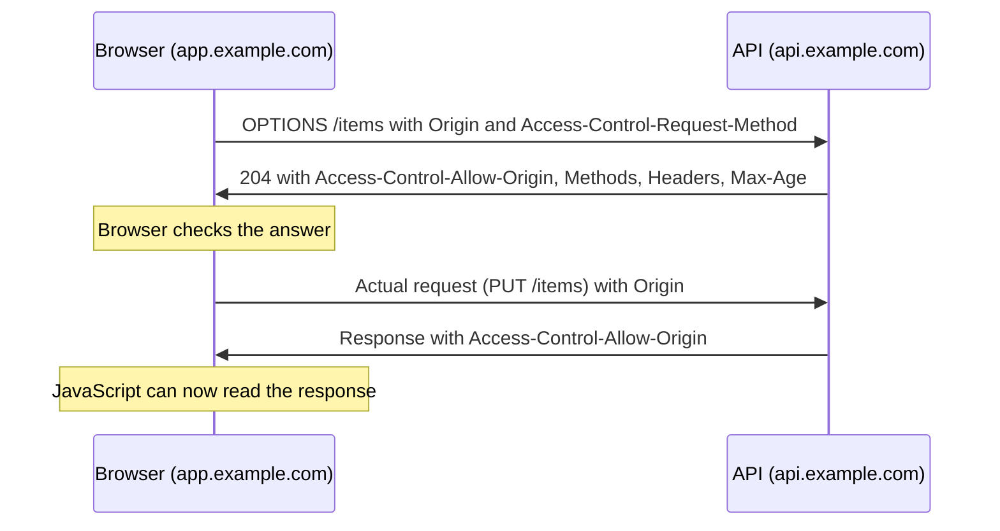
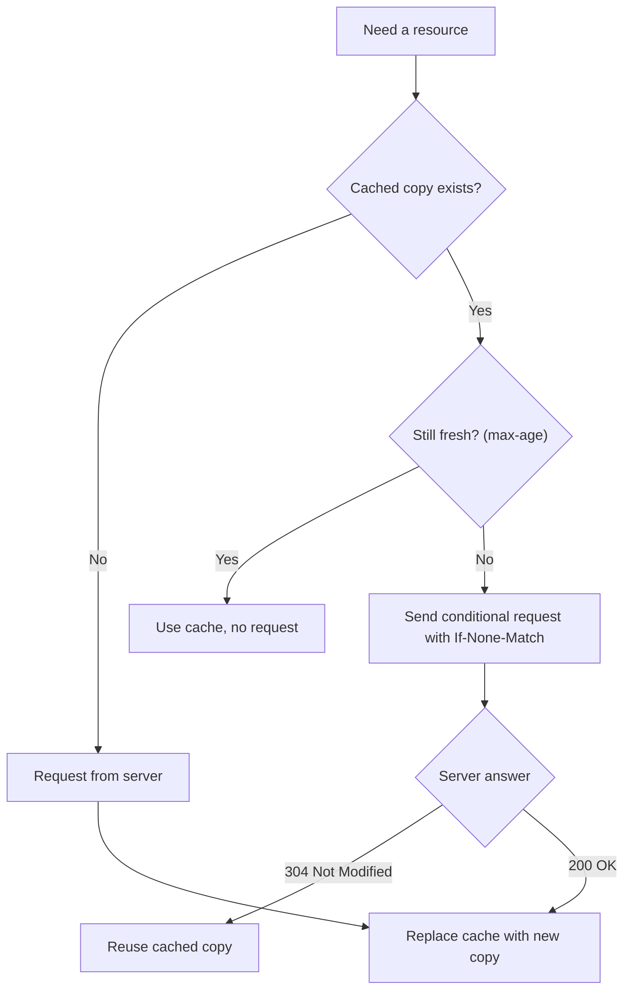
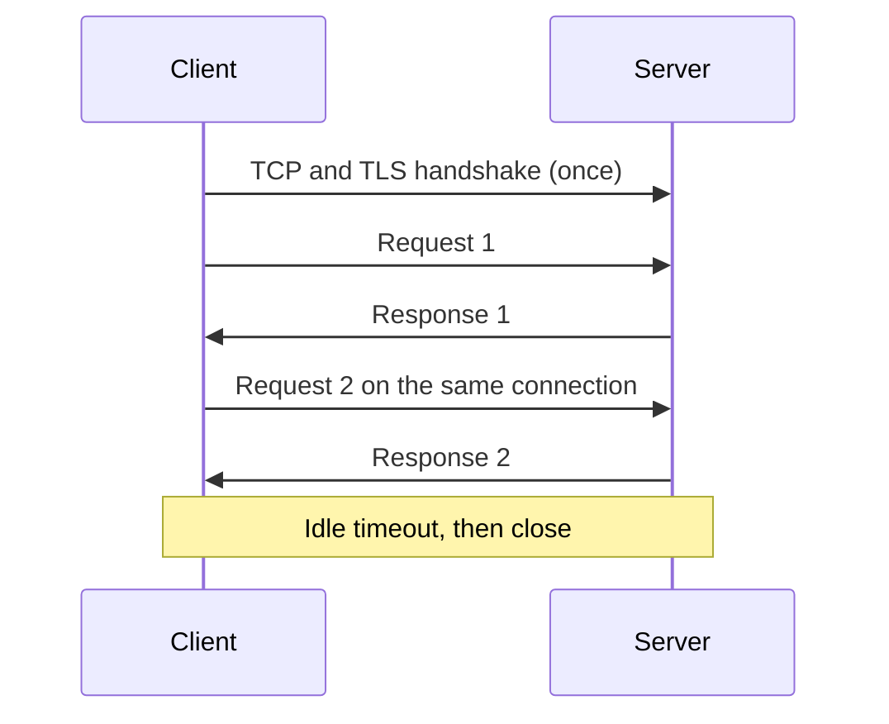
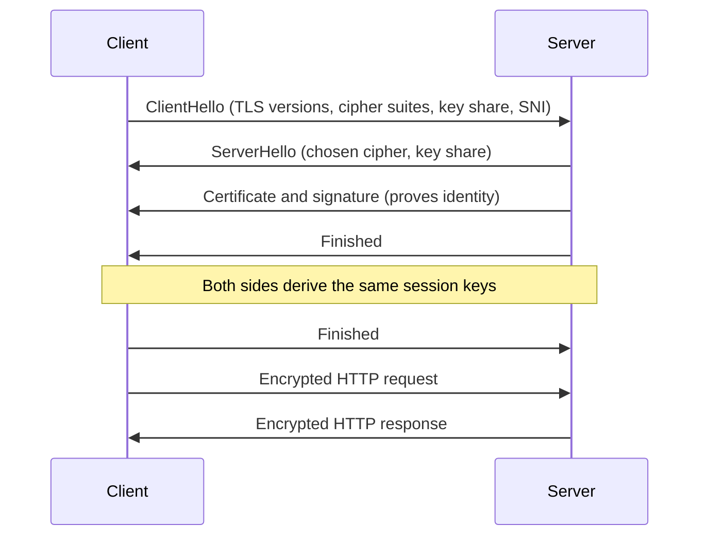

# HTTP and HTTPS Explained: Messages, Headers, CORS, Caching, TLS

A beginner-to-engineer reference for how the web talks: **HTTP messages**, **headers**, **methods**, **CORS**, **status codes**, **caching**, **content negotiation**, **compression**, **keep-alive**, **multipart and chunked transfer**, and **SSL/TLS/HTTPS**. It ends with extras that are worth knowing (security headers, what happens when you type a URL).

---

## Quick summary

- **HTTP** is a text-based, request/response, **stateless** protocol between a client and a server.
- A message is **start line + headers + blank line + optional body**.
- **Headers** carry metadata (who, what, how long to cache, which format).
- **Methods** say what to do (`GET`, `POST`, ...). **Status codes** say what happened (`200`, `404`, ...).
- **CORS** is a browser rule that decides whether a web page may read responses from another origin. It is **not** server-side protection.
- **Caching, compression, keep-alive** make HTTP fast.
- **HTTPS = HTTP over TLS**: encryption, integrity, and server identity.

---

## Table of contents

1. [Big picture](#1-big-picture)
2. [HTTP basics](#2-http-basics)
3. [Evolution of HTTP](#3-evolution-of-http)
4. [HTTP messages](#4-http-messages)
5. [HTTP headers](#5-http-headers)
6. [HTTP methods](#6-http-methods)
7. [Idempotent vs non-idempotent](#7-idempotent-vs-non-idempotent)
8. [OPTIONS method and CORS](#8-options-method-and-cors)
9. [CORS demo with curl and Burp Suite](#9-cors-demo-with-curl-and-burp-suite)
10. [Response status codes](#10-response-status-codes)
11. [Status codes demo](#11-status-codes-demo)
12. [HTTP caching](#12-http-caching)
13. [Content negotiation](#13-content-negotiation)
14. [Compression](#14-compression)
15. [Persistent connections and keep-alive](#15-persistent-connections-and-keep-alive)
16. [Multipart data and chunked transfer](#16-multipart-data-and-chunked-transfer)
17. [SSL, TLS and HTTPS](#17-ssl-tls-and-https)
18. [Security headers (extra)](#18-security-headers-extra)
19. [What happens when you type a URL (extra)](#19-what-happens-when-you-type-a-url-extra)
20. [Checklist: things to remember](#20-checklist-things-to-remember)
21. [Common pitfalls and interview questions](#21-common-pitfalls-and-interview-questions)

---

## 1. Big picture

Every web interaction follows the same loop:

1. The **client** (browser, mobile app, `curl`) opens a connection.
2. It sends an **HTTP request**.
3. The **server** processes it and sends an **HTTP response**.
4. The connection is reused or closed.



Everything else in this guide is a detail of that loop: how the messages look, how to make them fast, how to secure them.

---

## 2. HTTP basics

- **HTTP** = HyperText Transfer Protocol. It sits on top of **TCP** (and on top of **QUIC/UDP** in HTTP/3).
- **Client-server**: the client always starts the conversation.
- **Stateless**: the server does not remember earlier requests. Anything that must be remembered (login, cart) is carried by cookies, tokens, or stored server-side (see the authentication guide).
- **Text-based** (HTTP/1.x): you can read the messages by eye. HTTP/2 and 3 are binary, but they carry the same concepts.
- Default ports: **80** for HTTP, **443** for HTTPS.

**Anatomy of a URL**

```
https://user@api.example.com:8443/v1/images/42?size=large&fmt=png#top
└─┬──┘   └─┬─┘ └──────┬──────┘└─┬─┘└────┬─────┘└──────┬────────┘└┬┘
scheme  userinfo     host     port    path         query       fragment
```

- The **fragment** (`#top`) is never sent to the server.
- An **origin** is `scheme + host + port` (important for CORS).

---

## 3. Evolution of HTTP

| Version | Year | Key ideas |
|---|---|---|
| **HTTP/0.9** | 1991 | One method (`GET`), no headers, returns raw HTML. |
| **HTTP/1.0** | 1996 | Headers, status codes, `POST`/`HEAD`. One connection per request (slow). |
| **HTTP/1.1** | 1997 | Persistent connections by default, `Host` header (virtual hosting), chunked transfer, caching controls, `PUT`/`DELETE`/`OPTIONS`. Still widely used. |
| **HTTP/2** | 2015 | **Binary framing**, **multiplexing** many requests on one connection, **header compression (HPACK)**. Fixes HTTP-level head-of-line blocking. |
| **HTTP/3** | 2022 | Runs over **QUIC (UDP)**: faster handshakes, no TCP head-of-line blocking, better on flaky mobile networks. Header compression is **QPACK**. |

Important: the **meaning** (methods, status codes, headers) stays the same across versions. Only the way messages travel on the wire changes.

---

## 4. HTTP messages

**Request**

```http
POST /v1/images HTTP/1.1
Host: api.example.com
Authorization: Bearer eyJhbGciOi...
Content-Type: application/json
Content-Length: 27

{"title": "My first image"}
```

- **Request line**: `METHOD PATH VERSION`
- **Headers**: `Name: value`, one per line
- **Blank line**: marks the end of headers
- **Body**: optional (usually empty for `GET`)

**Response**

```http
HTTP/1.1 201 Created
Content-Type: application/json
Content-Length: 31
Location: /v1/images/42

{"id": 42, "title": "My first image"}
```

- **Status line**: `VERSION STATUS-CODE REASON`
- Then headers, a blank line, and the body.

In HTTP/2 and 3 the same information is sent in binary frames, with pseudo-headers like `:method` and `:path` replacing the request line.

---

## 5. HTTP headers

**Why do we need headers?**
The body is only the *content*. Headers answer everything around it: who is asking, which host, what format, how big, can it be cached, who is allowed, which language, and so on. Without headers, every request would need a rigid fixed format, and HTTP could not be extended without breaking things.

**Types of headers (by who sends them)**

| Type | Sent by | Examples |
|---|---|---|
| **Request headers** | Client | `Host`, `User-Agent`, `Accept`, `Authorization`, `Cookie`, `Origin`, `If-None-Match` |
| **Response headers** | Server | `Server`, `Set-Cookie`, `Location`, `WWW-Authenticate`, `Retry-After` |
| **Representation headers** (describe the body, either direction) | Both | `Content-Type`, `Content-Length`, `Content-Encoding`, `Content-Language` |
| **General headers** | Both | `Date`, `Connection`, `Via`, `Cache-Control` |

**Types of headers (by purpose)**

| Purpose | Examples |
|---|---|
| Authentication | `Authorization`, `WWW-Authenticate` |
| Cookies | `Cookie`, `Set-Cookie` |
| Caching | `Cache-Control`, `ETag`, `Last-Modified`, `Expires`, `Age`, `Vary` |
| Content negotiation | `Accept`, `Accept-Language`, `Accept-Encoding` |
| CORS | `Origin`, `Access-Control-*` |
| Connection | `Connection`, `Keep-Alive`, `Upgrade` |
| Redirect | `Location` |
| Proxy/forwarding | `X-Forwarded-For`, `X-Forwarded-Proto`, `Forwarded`, `Via` |
| Security | `Strict-Transport-Security`, `Content-Security-Policy`, ... (see section 18) |

**Notes**

- Header names are **case-insensitive** (`content-type` = `Content-Type`). HTTP/2 and 3 send them lowercase.
- Custom headers used to start with `X-` (e.g. `X-Request-Id`). That prefix is no longer recommended, but you will see it everywhere.
- Never trust client headers blindly (`X-Forwarded-For`, `User-Agent`, `Origin`...). Anyone can send anything with `curl`.

---

## 6. HTTP methods

| Method | Purpose | Has body? | Typical use |
|---|---|---|---|
| **GET** | Read a resource | No | Fetch a page or JSON |
| **POST** | Create / run an action | Yes | Create a record, submit a form, login |
| **PUT** | **Replace** a resource entirely | Yes | Overwrite user profile |
| **PATCH** | **Partially update** a resource | Yes | Change only the email |
| **DELETE** | Remove a resource | Usually no | Delete an image |
| **HEAD** | Like `GET` but **headers only** | No | Check size/ETag without downloading |
| **OPTIONS** | Ask what is allowed (CORS preflight) | No | Discover methods, CORS |

Rules of thumb:

- Do not change data with `GET`. Crawlers, prefetchers and caches assume `GET` is harmless.
- `POST` is for "create" and for actions that do not fit elsewhere.
- Responding `405 Method Not Allowed` should include an `Allow` header listing valid methods.

---

## 7. Idempotent vs non-idempotent

Two properties worth separating:

- **Safe**: does not change server state.
- **Idempotent**: sending the same request **many times has the same effect as sending it once**.

| Method | Safe | Idempotent |
|---|---|---|
| GET | Yes | Yes |
| HEAD | Yes | Yes |
| OPTIONS | Yes | Yes |
| PUT | No | **Yes** |
| DELETE | No | **Yes** |
| POST | No | **No** |
| PATCH | No | **Not guaranteed** |

**Why it matters**

- Networks fail. If a response is lost, can the client safely **retry**?
  - `PUT /users/7 {name: "Ana"}` twice leaves the same result. Safe to retry.
  - `DELETE /images/42` twice: the first deletes it, the second returns `404`, but the server state is the same. Idempotent.
  - `POST /payments` twice can charge the customer **twice**. Not safe to retry blindly.
- **Fix for POST**: send an **idempotency key** (`Idempotency-Key: <uuid>`). The server stores the result for that key and returns the same response on retry. This is how payment APIs work.
- `PATCH` like `{"count": 5}` is idempotent, but `{"increment": 1}` is not.

---

## 8. OPTIONS method and CORS

### The problem: Same-Origin Policy

Browsers enforce the **Same-Origin Policy (SOP)**: JavaScript on one origin cannot **read** responses from another origin.

Two URLs are the **same origin** only if **scheme, host and port** all match.

| Page origin | Request to | Same origin? |
|---|---|---|
| `https://app.example.com` | `https://app.example.com/api` | Yes |
| `https://app.example.com` | `http://app.example.com/api` | No (scheme) |
| `https://app.example.com` | `https://api.example.com` | No (host) |
| `https://app.example.com` | `https://app.example.com:8443` | No (port) |

### CORS: the controlled exception

**CORS (Cross-Origin Resource Sharing)** lets a server tell the browser: "this other origin is allowed to read my responses." It works through headers.

Key facts:

- CORS is **enforced by the browser**. The request usually still **reaches** the server. The browser only decides whether JavaScript may read the response.
- `curl`, Postman, Burp and other servers **ignore CORS completely**. So CORS does **not** protect your API from attackers. It protects **users' browsers**. You still need authentication and authorization.

### Simple vs preflighted requests

A request is **simple** (no preflight) only if **all** are true:

- Method is `GET`, `HEAD` or `POST`.
- Only "safe" headers are set (`Accept`, `Accept-Language`, `Content-Language`, `Content-Type`).
- `Content-Type` is one of `application/x-www-form-urlencoded`, `multipart/form-data`, `text/plain`.

Anything else (e.g. `PUT`/`DELETE`, an `Authorization` header, `Content-Type: application/json`) triggers a **preflight**: the browser first sends an automatic `OPTIONS` request to ask permission.



**Preflight request**

```http
OPTIONS /items/7 HTTP/1.1
Host: api.example.com
Origin: https://app.example.com
Access-Control-Request-Method: PUT
Access-Control-Request-Headers: authorization, content-type
```

**Preflight response**

```http
HTTP/1.1 204 No Content
Access-Control-Allow-Origin: https://app.example.com
Access-Control-Allow-Methods: GET, POST, PUT, DELETE
Access-Control-Allow-Headers: Authorization, Content-Type
Access-Control-Max-Age: 600
Vary: Origin
```

### CORS response headers

| Header | Meaning |
|---|---|
| `Access-Control-Allow-Origin` | Which origin may read the response (one origin or `*`) |
| `Access-Control-Allow-Methods` | Allowed methods (preflight) |
| `Access-Control-Allow-Headers` | Allowed request headers (preflight) |
| `Access-Control-Allow-Credentials: true` | Allow cookies / auth with the request |
| `Access-Control-Expose-Headers` | Extra response headers JS may read |
| `Access-Control-Max-Age` | How long (seconds) the browser may cache the preflight answer |

### Rules and common mistakes

- With credentials (`Allow-Credentials: true`), the server **cannot** use `*` for origin, methods, or headers. Use an explicit origin.
- On the client, cookies are only sent cross-origin if you opt in (`fetch(url, { credentials: "include" })`).
- **Dangerous**: blindly echoing the request's `Origin` back in `Access-Control-Allow-Origin` together with `Allow-Credentials: true`. That lets *any* website read a logged-in user's data. Always compare against an **allowlist**.
- Add `Vary: Origin` when the allowed origin changes per request, so caches do not mix responses.
- `Access-Control-Allow-Origin: *` is fine for truly public, credential-less data (public APIs, fonts, CDN files).
- A CORS error in the browser console does not mean the server failed. The request may have succeeded, but the browser hid the response.

---

## 9. CORS demo with curl and Burp Suite

> Only test systems you own or have written permission to test.

### A small API to experiment on (FastAPI)

```python
# file: cors_demo.py
from fastapi import FastAPI
from fastapi.middleware.cors import CORSMiddleware

app = FastAPI()

app.add_middleware(
    CORSMiddleware,
    allow_origins=["https://app.example.com"],   # explicit allowlist
    allow_credentials=True,
    allow_methods=["GET", "POST", "PUT", "DELETE"],
    allow_headers=["Authorization", "Content-Type"],
    max_age=600,
)


@app.get("/data")
def data():
    return {"secret": "only for allowed origins to read in a browser"}
```

Run it: `uvicorn cors_demo:app --port 8000`

### Demo 1: watch the preflight with curl

```bash
# Preflight from an ALLOWED origin
curl -i -X OPTIONS http://localhost:8000/data \
  -H "Origin: https://app.example.com" \
  -H "Access-Control-Request-Method: PUT" \
  -H "Access-Control-Request-Headers: authorization"

# Preflight from a DIFFERENT origin
curl -i -X OPTIONS http://localhost:8000/data \
  -H "Origin: https://evil.example" \
  -H "Access-Control-Request-Method: PUT"
```

What to notice:

- Allowed origin: response has `Access-Control-Allow-Origin: https://app.example.com`.
- Other origin: no `Access-Control-Allow-Origin` header (the browser would block it).

### Demo 2: CORS is not security

```bash
curl -i http://localhost:8000/data -H "Origin: https://evil.example"
```

The server still returns `200` with the data. `curl` does not care about CORS. Only a **browser** would refuse to hand that response to a page from `evil.example`. This is why your API still needs real authentication and authorization.

### Demo 3: Burp Suite walkthrough

1. Start Burp Suite, go to **Proxy**, and turn **Intercept on**.
2. Configure the browser to use the proxy `127.0.0.1:8080` (or use Burp's built-in browser).
3. Open your front-end page and trigger a cross-origin call. In **Proxy > HTTP history**, find the **`OPTIONS`** preflight, followed by the real request.
4. Right-click a request and choose **Send to Repeater**.
5. In **Repeater**, change the `Origin` header (e.g. `https://evil.example`) and click **Send**.
6. Read the response headers:
   - **Secure**: no `Access-Control-Allow-Origin` for unknown origins, or only your allowlisted origin.
   - **Misconfigured**: the server **reflects** `https://evil.example` and also sends `Access-Control-Allow-Credentials: true`. That is a real vulnerability.
7. Also try `Origin: null` and an origin like `https://app.example.com.evil.example` to check for sloppy "contains" or "endswith" matching.

Take-away: the browser enforces CORS, Burp is **not** a browser, so it lets you see exactly what the server is willing to say.

---

## 10. Response status codes

Status codes are grouped by their first digit:

| Range | Meaning |
|---|---|
| **1xx** | Informational |
| **2xx** | Success |
| **3xx** | Redirection |
| **4xx** | **Client** error (you sent something wrong) |
| **5xx** | **Server** error (the server failed) |

**Codes you must know**

| Code | Name | When to use |
|---|---|---|
| 100 | Continue | Client may send the body (`Expect: 100-continue`) |
| 101 | Switching Protocols | Upgrade to WebSocket |
| **200** | OK | Standard success |
| **201** | Created | Resource created (include `Location`) |
| 202 | Accepted | Accepted, processing later (async job) |
| **204** | No Content | Success, nothing to return (common for `DELETE`, preflight) |
| 206 | Partial Content | Range request (video seeking, resumable downloads) |
| **301** | Moved Permanently | URL changed forever (SEO, cached) |
| **302** | Found | Temporary redirect |
| 303 | See Other | After `POST`, go `GET` another URL |
| **304** | Not Modified | Cached copy is still valid (no body) |
| 307 | Temporary Redirect | Temporary, **keep the method** |
| 308 | Permanent Redirect | Permanent, **keep the method** |
| **400** | Bad Request | Malformed request |
| **401** | Unauthorized | **Not authenticated** (really "unauthenticated") |
| **403** | Forbidden | Authenticated but **not allowed** |
| **404** | Not Found | Resource does not exist (or you hide it) |
| 405 | Method Not Allowed | Method not supported on this URL |
| 406 | Not Acceptable | Cannot produce an acceptable format |
| 409 | Conflict | State conflict (duplicate, version mismatch) |
| 410 | Gone | Was here, deleted on purpose |
| 413 | Content Too Large | Body too big |
| 415 | Unsupported Media Type | Wrong `Content-Type` |
| 422 | Unprocessable Content | Valid syntax, invalid data (FastAPI validation errors) |
| **429** | Too Many Requests | Rate limited (send `Retry-After`) |
| **500** | Internal Server Error | Unhandled bug |
| 501 | Not Implemented | Server does not support the feature |
| **502** | Bad Gateway | Proxy got a bad answer from upstream |
| **503** | Service Unavailable | Overloaded / maintenance (send `Retry-After`) |
| **504** | Gateway Timeout | Proxy timed out waiting for upstream |

**Commonly confused pairs**

- **401 vs 403**: 401 = "I don't know who you are" (should send `WWW-Authenticate`). 403 = "I know who you are, and the answer is no."
- **301/302 vs 307/308**: older 301/302 let clients change `POST` into `GET`. **307/308 guarantee the method and body are kept.**
- **400 vs 422**: 400 = cannot even parse. 422 = parsed fine but fails validation rules.
- **502 vs 504**: 502 = upstream replied badly. 504 = upstream did not reply in time.

---

## 11. Status codes demo

### With curl

```bash
# See status + headers
curl -i https://httpbin.org/status/404

# Only the status code
curl -s -o /dev/null -w "%{http_code}\n" https://httpbin.org/status/418

# Follow a redirect and watch each hop
curl -iL https://httpbin.org/redirect/2

# Headers only (HEAD)
curl -I https://example.com
```

### With FastAPI

```python
# file: status_demo.py
from fastapi import FastAPI, HTTPException, Response
from fastapi.responses import RedirectResponse

app = FastAPI()
items: dict[int, str] = {}


@app.post("/items/{item_id}", status_code=201)          # Created
def create_item(item_id: int, name: str, response: Response):
    if item_id in items:
        raise HTTPException(status_code=409, detail="Item already exists")   # Conflict
    items[item_id] = name
    response.headers["Location"] = f"/items/{item_id}"
    return {"id": item_id, "name": name}


@app.get("/items/{item_id}")
def read_item(item_id: int):
    if item_id not in items:
        raise HTTPException(status_code=404, detail="Item not found")        # Not Found
    return {"id": item_id, "name": items[item_id]}


@app.delete("/items/{item_id}", status_code=204)        # No Content
def delete_item(item_id: int):
    items.pop(item_id, None)                             # idempotent delete


@app.get("/old-path")
def old_path():
    return RedirectResponse("/items/1", status_code=308)   # Permanent, keeps method
```

Try: `POST` the same item twice (201 then 409), `GET` a missing id (404), `GET /items/abc` (FastAPI returns **422** for the invalid integer).

---

## 12. HTTP caching

Caching avoids re-downloading things that have not changed. It happens in the **browser**, in **proxies/CDNs**, and on the **server side**.

### Two ideas

1. **Freshness**: for how long can a stored copy be used with **no** network request?
2. **Validation**: when it is stale, **ask** the server "has it changed?" instead of downloading again.

### Cache-Control (response)

| Directive | Meaning |
|---|---|
| `max-age=3600` | Fresh for 3600 seconds |
| `s-maxage=3600` | Same, but for **shared caches** (CDNs) only |
| `public` | Any cache may store it |
| `private` | Only the user's browser may store it (personalized data) |
| `no-cache` | May store, but **must revalidate** before every use |
| `no-store` | **Do not store at all** (sensitive data) |
| `must-revalidate` | After it expires, must revalidate (no serving stale) |
| `immutable` | Will never change (use with versioned filenames) |

> Classic mix-up: **`no-cache` does not mean "don't cache."** It means "check with the server before reusing." For "never store," use **`no-store`**.

### Validators

- **`ETag: "abc123"`**: a fingerprint of the content. The client later sends **`If-None-Match: "abc123"`**.
- **`Last-Modified: <date>`**: the client later sends **`If-Modified-Since: <date>`**.
- If unchanged, the server replies **`304 Not Modified`** with **no body**. The client reuses its copy.



**Example exchange**

```http
GET /logo.png HTTP/1.1
Host: example.com

HTTP/1.1 200 OK
Cache-Control: public, max-age=86400
ETag: "v42"
```

Later, after the copy becomes stale:

```http
GET /logo.png HTTP/1.1
Host: example.com
If-None-Match: "v42"

HTTP/1.1 304 Not Modified
ETag: "v42"
```

### Other caching headers

- **`Expires`**: old absolute-date version of `max-age` (`Cache-Control` wins).
- **`Age`**: how many seconds the copy has been in a shared cache.
- **`Vary`**: which request headers change the response (e.g. `Vary: Accept-Encoding, Accept-Language`). Caches keep separate copies per variant.

### Practical recipes

| Content | Header |
|---|---|
| Versioned static files (`app.3f9a.js`) | `Cache-Control: public, max-age=31536000, immutable` |
| HTML pages | `Cache-Control: no-cache` + `ETag` (always revalidate) |
| Personalized API responses | `Cache-Control: private, max-age=60` |
| Sensitive data (banking, tokens) | `Cache-Control: no-store` |

```python
# FastAPI example
from fastapi import Response

@app.get("/logo")
def logo(response: Response):
    response.headers["Cache-Control"] = "public, max-age=86400"
    response.headers["ETag"] = '"v42"'
    return {"logo": "..."}
```

---

## 13. Content negotiation

The same URL can be served in different **representations** (format, language, encoding). The client states preferences; the server picks.

| Client header | Asks for | Example |
|---|---|---|
| `Accept` | Media type | `Accept: application/json` |
| `Accept-Language` | Language | `Accept-Language: en-US,en;q=0.8,fr;q=0.5` |
| `Accept-Encoding` | Compression | `Accept-Encoding: gzip, br` |

| Server header | Tells the client |
|---|---|
| `Content-Type` | The format actually sent (`application/json; charset=utf-8`) |
| `Content-Language` | The language sent |
| `Content-Encoding` | The compression used (`gzip`) |
| `Vary` | Which request headers influenced the choice |

**Quality values (`q`)** rank preferences from `0` to `1` (default `1`):
`Accept: text/html, application/json;q=0.9, */*;q=0.1` means "HTML if you can, else JSON, else anything."

**Failure cases**

- Server cannot produce what was asked: **`406 Not Acceptable`**.
- Client sends a body in an unsupported format: **`415 Unsupported Media Type`**.

**Types**

- **Server-driven** (headers above) is the most common.
- **Agent-driven** is when the server offers a list of choices (`300 Multiple Choices`) and the client picks. This is rare.
- Always send `Vary` so caches do not serve the wrong variant.

---

## 14. Compression

Compression shrinks text-based responses (HTML, CSS, JS, JSON) by 70-90%, so pages load faster and cost less bandwidth.

**Flow**

```http
GET /app.js HTTP/1.1
Accept-Encoding: gzip, br

HTTP/1.1 200 OK
Content-Encoding: br
Content-Type: text/javascript
Vary: Accept-Encoding
```

| Algorithm | Notes |
|---|---|
| **gzip** | Universal, good default |
| **br (Brotli)** | Better ratio, great for static assets (browsers use it over HTTPS) |
| **zstd** | Fast, modern; support is growing |
| **deflate** | Legacy |

**Good practice**

- Compress text formats. **Do not** compress images, video, or zip files (already compressed, wastes CPU).
- Pre-compress static files at build time (Brotli level 11); compress dynamic responses with a faster level.
- Always send `Vary: Accept-Encoding`.
- Security note: compressing responses that mix secrets with attacker-controlled input can enable **BREACH**-style attacks. Mitigate with CSRF tokens that change per request, and avoid reflecting user input next to secrets.
- Do not confuse **`Content-Encoding`** (compression of the body) with **`Transfer-Encoding`** (how the message is transmitted, e.g. chunked).

```python
# FastAPI: gzip responses larger than 1 KB
from fastapi.middleware.gzip import GZipMiddleware
app.add_middleware(GZipMiddleware, minimum_size=1000)
```

---

## 15. Persistent connections and keep-alive

**The problem**: opening a TCP connection (and a TLS handshake) for every request is slow.

- **HTTP/1.0**: one connection per request by default.
- **HTTP/1.1**: connections are **persistent by default**. One connection serves many requests one after another.
- `Connection: keep-alive` makes it explicit (needed mainly for HTTP/1.0 clients). `Connection: close` asks to close after this response.
- `Keep-Alive: timeout=5, max=100` (optional hint) tells the client how long the idle connection stays open and how many requests it can serve.



**Related ideas**

- **Head-of-line blocking (HTTP/1.1)**: on one connection, responses must come back **in order**. A slow response blocks the ones behind it. Browsers work around this by opening about 6 connections per host.
- **HTTP pipelining** (sending requests without waiting) existed but was never reliably supported, so it is effectively dead.
- **HTTP/2** fixes this with **multiplexing**: many streams interleaved on **one** connection.
- **HTTP/3** removes head-of-line blocking at the transport level too.
- Reverse proxies and load balancers also keep persistent connections to your backend. Make sure their idle timeouts are shorter or longer than each other consistently, or you will see random `502` errors.

---

## 16. Multipart data and chunked transfer

### Multipart (`multipart/form-data`)

Used to send **files and fields together** (file uploads, HTML forms with files). The body is split into parts separated by a **boundary** string.

```http
POST /upload HTTP/1.1
Host: api.example.com
Content-Type: multipart/form-data; boundary=----X1Y2Z3

------X1Y2Z3
Content-Disposition: form-data; name="title"

Holiday photo
------X1Y2Z3
Content-Disposition: form-data; name="file"; filename="beach.jpg"
Content-Type: image/jpeg

<binary bytes of the image>
------X1Y2Z3--
```

- Each part has its own headers (`Content-Disposition`, optional `Content-Type`).
- The boundary must **not** appear inside the data. The client generates a random one.
- The last boundary ends with `--`.

```bash
# curl builds the multipart body for you
curl -F "title=Holiday photo" -F "file=@beach.jpg" http://localhost:8000/upload
```

```python
# FastAPI (needs: pip install python-multipart)
from fastapi import File, Form, UploadFile

@app.post("/upload")
async def upload(title: str = Form(...), file: UploadFile = File(...)):
    return {"title": title, "filename": file.filename, "type": file.content_type}
```

Also remember: validate file type, size, and name on the server. Never trust the filename or `Content-Type` sent by the client.

### Chunked transfer encoding

Normally the server sends `Content-Length` so the client knows the size. But when the server **does not know the total size in advance** (streaming, generated output, long-running responses), it uses:

```
Transfer-Encoding: chunked
```

The body is sent as **chunks**: each chunk is its size in hexadecimal, then the data. A chunk of size `0` ends the message.

```http
HTTP/1.1 200 OK
Content-Type: text/plain
Transfer-Encoding: chunked

7\r\n
Mozilla\r\n
9\r\n
Developer\r\n
0\r\n
\r\n
```

(`\r\n` = carriage return + line feed. The decoded body is `MozillaDeveloper`.)

**Key points**

- Chunked and `Content-Length` are **alternatives**. Use one, not both.
- Great for **streaming** (large exports, server-sent events, LLM token streaming).
- HTTP/1.1 only. HTTP/2 and 3 have their own framing, so `Transfer-Encoding: chunked` is not used there.
- Trailers (headers after the last chunk) are possible but rarely used.

```python
# FastAPI: streaming response (sent in chunks)
import asyncio
from fastapi.responses import StreamingResponse

async def numbers():
    for i in range(5):
        yield f"line {i}\n"
        await asyncio.sleep(1)

@app.get("/stream")
def stream():
    return StreamingResponse(numbers(), media_type="text/plain")
```

Try: `curl -N http://localhost:8000/stream` and watch the lines arrive one by one.

---

## 17. SSL, TLS and HTTPS

### The problem with plain HTTP

HTTP sends everything in **clear text**. Anyone on the path (Wi-Fi, ISP, proxy) can:

- **Read** passwords, cookies, tokens (no confidentiality)
- **Modify** responses, e.g. inject ads or malware (no integrity)
- **Impersonate** the server (no authentication)

### The fix: TLS

- **SSL** (Secure Sockets Layer) is the old name. SSL 2.0 and 3.0 are **broken and obsolete**.
- **TLS** (Transport Layer Security) is the modern protocol. Use **TLS 1.2 or 1.3**. TLS 1.0 and 1.1 are deprecated. People still say "SSL certificate," but they mean a TLS certificate.
- **HTTPS = HTTP carried inside a TLS connection** (port 443).

TLS gives three guarantees:

| Guarantee | How |
|---|---|
| **Confidentiality** | Data is encrypted (symmetric encryption, e.g. AES-GCM or ChaCha20) |
| **Integrity** | Every record is authenticated, so tampering is detected |
| **Authentication** | The server proves its identity with a **certificate** |

### Certificates and trust

- A **certificate** binds a **domain name** to a **public key**, signed by a **Certificate Authority (CA)**.
- Browsers and operating systems ship with a list of trusted **root CAs**.
- Servers present a **chain**: your certificate, then intermediate CA(s), then a trusted root.
- The browser checks: the signature chain, the **domain name matches**, the certificate is **not expired or revoked**.
- Free, automated certificates: **Let's Encrypt** (ACME protocol, e.g. `certbot`, Caddy).
- **SNI (Server Name Indication)**: the client states the hostname during the handshake so one IP can serve many HTTPS sites.

### The idea behind the handshake

- **Asymmetric cryptography** (public/private keys) is slow, but lets two strangers agree on a secret.
- **Symmetric cryptography** is fast, but both sides need the same secret key.
- TLS uses asymmetric math only to **agree on a shared session key** (via an ephemeral Diffie-Hellman exchange). After that, all data uses fast symmetric encryption.

### Simplified TLS 1.3 handshake



- **TLS 1.3 needs 1 round trip** before data flows (TLS 1.2 needs 2). It also supports 0-RTT resumption (with replay caveats).
- **Forward secrecy**: session keys are temporary. If the server's private key leaks later, **past recorded traffic still cannot be decrypted**. TLS 1.3 enforces this.
- TLS 1.3 removed weak options (RSA key exchange, old ciphers, compression).

### What HTTPS does NOT hide

- The **domain name** (visible via DNS and SNI, unless using DoH/ECH) and the **IP address**.
- Roughly **how much data** is transferred, and when.
- It does not make the **application** secure (SQL injection, broken authorization still work).

### Related concepts

- **HSTS** (`Strict-Transport-Security`): tells browsers to **only use HTTPS** for this site for a time, blocking downgrade attacks.
- **Mixed content**: an HTTPS page loading HTTP resources (scripts, images). Browsers block or warn.
- **HTTP to HTTPS redirect**: serve a `301`/`308` from port 80 to 443.
- **Secure cookies**: use the `Secure` attribute so cookies are only sent over HTTPS (see the authentication guide).
- **mTLS (mutual TLS)**: the **client** also presents a certificate. Common between microservices and in zero-trust setups.
- **TLS termination**: often a load balancer or reverse proxy (Nginx, Cloudflare) handles TLS, then forwards plain HTTP to your app inside a private network. Your app should read `X-Forwarded-Proto` to know the original scheme, and only trust it from your own proxy.
- **Certificate pinning** and **Certificate Transparency** exist to catch rogue certificates. Pinning is risky to operate and mostly used in mobile apps.

### Inspect it yourself

```bash
# See TLS version, cipher, certificate chain
curl -v https://example.com 2>&1 | head -40

# Detailed certificate info
openssl s_client -connect example.com:443 -servername example.com </dev/null
```

---

## 18. Security headers (extra)

Cheap, effective response headers that harden browser behavior.

| Header | Purpose | Example |
|---|---|---|
| `Strict-Transport-Security` | Force HTTPS | `max-age=31536000; includeSubDomains` |
| `Content-Security-Policy` | Restrict where scripts/styles/images load from (strong XSS defense) | `default-src 'self'` |
| `X-Content-Type-Options` | Stop MIME sniffing | `nosniff` |
| `X-Frame-Options` (or CSP `frame-ancestors`) | Prevent clickjacking | `DENY` |
| `Referrer-Policy` | Limit what URL info is leaked | `strict-origin-when-cross-origin` |
| `Permissions-Policy` | Disable browser features (camera, mic, ...) | `camera=(), microphone=()` |
| `Cross-Origin-Opener-Policy` | Isolate your window from other origins | `same-origin` |

You can check any site with a header scanner such as securityheaders.com.

---

## 19. What happens when you type a URL (extra)

Typing `https://example.com/page` and pressing Enter:

1. **Parse** the URL (scheme, host, path).
2. **DNS lookup**: browser cache, OS cache, then resolver, which returns an IP address.
3. **TCP connection** (or QUIC for HTTP/3) to the IP on port 443.
4. **TLS handshake**: negotiate keys and verify the certificate.
5. **HTTP request** is sent (`GET /page`, with cookies, `Accept-*` headers, etc.).
6. Possibly passes a **CDN / load balancer / reverse proxy**, then your app server and database.
7. **HTTP response** returns (status, headers, body, maybe compressed and cached).
8. The browser **parses HTML**, then fetches CSS, JS, images (each request reusing the connection, honoring caching).
9. It builds the page, runs JavaScript, and renders.

---

## 20. Checklist: things to remember

1. HTTP is **stateless**, request/response, and sits on TCP (or QUIC for HTTP/3).
2. A message = **start line + headers + blank line + body**.
3. **Headers** carry metadata. Names are case-insensitive. Never trust them blindly.
4. **GET** reads, **POST** creates, **PUT** replaces, **PATCH** edits partially, **DELETE** removes.
5. **Idempotent**: GET, HEAD, OPTIONS, PUT, DELETE. **Not**: POST (use an idempotency key). PATCH is not guaranteed.
6. **CORS** is enforced by the **browser**. It is not an API security feature.
7. **Preflight** = automatic `OPTIONS` before non-simple cross-origin requests.
8. Never combine `Allow-Credentials: true` with `*`, and never reflect `Origin` without an allowlist.
9. **401** = unauthenticated, **403** = forbidden. **307/308** keep the method.
10. **`no-cache`** = revalidate. **`no-store`** = never store.
11. **ETag + If-None-Match** gives a `304` with no body.
12. **Content negotiation** uses `Accept*` headers. Add `Vary`.
13. Compress **text** formats (gzip/Brotli), not already-compressed files.
14. **Keep-alive** reuses connections. HTTP/2 multiplexes, HTTP/3 uses QUIC.
15. **Multipart** = files + fields with boundaries. **Chunked** = streaming without known length.
16. **HTTPS = HTTP + TLS**: confidentiality, integrity, authentication.
17. Use **TLS 1.2+** (prefer 1.3), automate certificates, enable **HSTS**.

---

## 21. Common pitfalls and interview questions

**Pitfalls**

- Treating CORS as a security control, or "fixing" CORS errors with `Access-Control-Allow-Origin: *` plus credentials.
- Using `GET` for actions that change data.
- Returning `200` with an error message in the body instead of the proper `4xx/5xx` code.
- Confusing `no-cache` with `no-store`, leading to sensitive data being stored.
- Forgetting `Vary` when responses depend on `Origin`, `Accept-Encoding`, or `Accept-Language`.
- Retrying non-idempotent `POST` requests automatically and creating duplicates.
- Mixed content (HTTP assets on HTTPS pages) and missing HSTS.
- Believing "HTTPS means my app is secure."
- Trusting `X-Forwarded-For` from the internet instead of only from your own proxy.

**Interview questions**

- **What is the difference between HTTP/1.1, HTTP/2, and HTTP/3?**
  1.1: text, persistent connections, head-of-line blocking. 2: binary, multiplexing, header compression, over TCP. 3: same ideas over QUIC/UDP, no TCP head-of-line blocking, faster setup.
- **What is idempotency, and which methods have it?**
  Repeating the request gives the same server state. GET, HEAD, OPTIONS, PUT, DELETE are idempotent. POST is not, so use idempotency keys for payments.
- **PUT vs PATCH?**
  PUT replaces the whole resource. PATCH changes only the given fields.
- **How does CORS work, and what is a preflight?**
  The browser blocks cross-origin reads unless the server allows them via `Access-Control-*` headers. For non-simple requests, the browser first sends an `OPTIONS` preflight and proceeds only if the server approves.
- **Does CORS protect my API?**
  No. It only affects browsers. Attackers use `curl`. You still need authentication, authorization, and validation.
- **401 vs 403?**
  401 = not authenticated. 403 = authenticated but not permitted.
- **301 vs 302 vs 307 vs 308?**
  301/308 are permanent, 302/307 are temporary. 307 and 308 preserve the HTTP method and body.
- **How does HTTP caching work?**
  Freshness (`max-age`) lets the client skip the network. When stale, it revalidates with `ETag`/`If-None-Match`, and the server answers `304` if unchanged.
- **`no-cache` vs `no-store`?**
  `no-cache`: may store but must revalidate. `no-store`: never store.
- **What does `Transfer-Encoding: chunked` do?**
  Sends a body in size-prefixed chunks when the total length is unknown, enabling streaming.
- **How does the TLS handshake work?**
  Client and server agree on a version and cipher, exchange key shares (ephemeral Diffie-Hellman), the server proves identity with a certificate, and both derive symmetric session keys for the rest of the connection.
- **Why use both asymmetric and symmetric encryption in TLS?**
  Asymmetric lets strangers agree on a secret but is slow. Symmetric is fast for bulk data. TLS uses the first to set up the second.
- **What is HSTS?**
  A header that makes browsers use only HTTPS for a domain, preventing downgrade and SSL-stripping attacks.
- **What does HTTPS not protect?**
  The destination domain/IP and traffic volume are visible, and it does nothing against application-level bugs.
